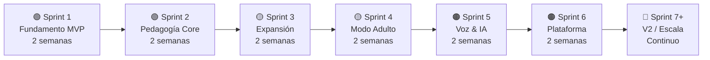
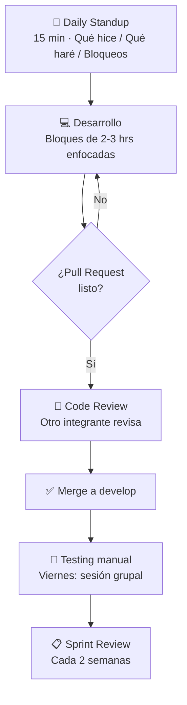

# 📚 Pino — Backlog Priorizado y Ruta del Proyecto

> **Equipo:** 4 integrantes · **Sprints:** 2 semanas c/u · **Total HU:** 22 (desglosadas en tareas)

---

## 👥 Distribución del Equipo

| Rol | Responsable | Foco principal |
|-----|-------------|----------------|
| **DEV-1** · Frontend UI | Integrante 1 | Pantallas, componentes visuales, animaciones, trazado canvas |
| **DEV-2** · Frontend Lógica | Integrante 2 | Navegación, estado global, lógica de ejercicios, drag & drop |
| **DEV-3** · Backend & Datos | Integrante 3 | Base de datos local, modelos de datos, sincronización, API |
| **DEV-4** · Audio & Contenido | Integrante 4 | Integración TTS/audio, contenido pedagógico, assets, accesibilidad |

> [!NOTE]
> Los roles no son silos rígidos. Todos tocan código compartido. El rol indica **ownership principal** y quién lidera las decisiones de esa área.

---

## 🗺️ Roadmap General

---

## 🟢 SPRINT 1 — Fundamento MVP (Semanas 1-2)

> **Meta:** Un usuario puede crear perfil, hacer diagnóstico, practicar fonemas con audio y tocar palabras para escucharlas. Todo funciona offline básico.

### HU-01: Configuración de perfil + diagnóstico

| ID Tarea | Tarea | Responsable | Puntos | Dependencia |
|----------|-------|-------------|--------|-------------|
| T-01.1 | Diseñar pantalla de selección de modo (asistido/autónomo) con iconos grandes | DEV-1 | 3 | — |
| T-01.2 | Implementar flujo de 3 preguntas diagnósticas (asociar letras → palabras → texto) | DEV-2 | 5 | — |
| T-01.3 | Crear modelo de datos `UserProfile` (edad, modo, nivel, configuración UI) | DEV-3 | 3 | — |
| T-01.4 | Grabar/integrar audios de instrucciones para cada paso del onboarding | DEV-4 | 3 | — |
| T-01.5 | Lógica de clasificación automática de nivel según respuestas del diagnóstico | DEV-2 | 3 | T-01.2 |
| T-01.6 | Aplicar tema visual dinámico (tipografía grande/infantil vs. estándar/adulto) según perfil | DEV-1 | 3 | T-01.3 |

**Subtotal: 20 puntos**

---

### HU-15: Multiperfil local

| ID Tarea | Tarea | Responsable | Puntos | Dependencia |
|----------|-------|-------------|--------|-------------|
| T-15.1 | Pantalla de selección de perfiles con avatares visuales (grid de íconos) | DEV-1 | 3 | — |
| T-15.2 | CRUD de perfiles en almacenamiento local (crear, editar avatar, eliminar) | DEV-3 | 5 | T-01.3 |
| T-15.3 | Contexto/estado global que aísla datos por perfil activo | DEV-2 | 5 | T-15.2 |
| T-15.4 | Navegación: máximo 2 toques para cambiar perfil desde menú principal | DEV-2 | 2 | T-15.1 |

**Subtotal: 15 puntos**

---

### HU-03: Asociación fonema-grafema con audio

| ID Tarea | Tarea | Responsable | Puntos | Dependencia |
|----------|-------|-------------|--------|-------------|
| T-03.1 | Pantalla de exploración: grilla de letras/sílabas con botón de audio individual | DEV-1 | 5 | — |
| T-03.2 | Grabar banco de fonemas puros en español neutro (a-z, sílabas directas: ma, me, mi...) | DEV-4 | 8 | — |
| T-03.3 | Servicio de reproducción de audio con precarga y baja latencia | DEV-4 | 5 | T-03.2 |
| T-03.4 | Ejercicio de emparejamiento: escuchar fonema → elegir entre 2-3 opciones de letras | DEV-2 | 5 | T-03.3 |
| T-03.5 | Lógica de evaluación y feedback visual (correcto/incorrecto) con animación | DEV-1 | 3 | T-03.4 |
| T-03.6 | Registrar resultados de cada ejercicio en modelo de datos `ExerciseResult` | DEV-3 | 3 | T-03.4 |

**Subtotal: 29 puntos**

---

### HU-14: Tap-to-Speech (simplificado)

| ID Tarea | Tarea | Responsable | Puntos | Dependencia |
|----------|-------|-------------|--------|-------------|
| T-14.1 | Componente reutilizable `TappableText` que detecta toque en palabra individual | DEV-2 | 5 | — |
| T-14.2 | Integrar motor TTS nativo del dispositivo para pronunciar palabra tocada | DEV-4 | 5 | — |
| T-14.3 | Micro-animación de separación silábica al reproducir audio | DEV-1 | 3 | T-14.1 |

**Subtotal: 13 puntos**

---

### HU-02: Trazado de letras (versión simplificada)

| ID Tarea | Tarea | Responsable | Puntos | Dependencia |
|----------|-------|-------------|--------|-------------|
| T-02.1 | Componente Canvas/SVG con trazo punteado y flechas de dirección para letras | DEV-1 | 8 | — |
| T-02.2 | Detección de trazo del usuario y cálculo de desviación vs. ruta ideal | DEV-2 | 8 | T-02.1 |
| T-02.3 | Feedback visual al completar trazo correcto + reproducir fonema de la letra | DEV-4 | 3 | T-02.2, T-03.3 |
| T-02.4 | Datos de trazos vectoriales para las vocales (A, E, I, O, U) — fase 1 | DEV-4 | 5 | — |

**Subtotal: 24 puntos**

---

### HU-10: Modo offline (parcial)

| ID Tarea | Tarea | Responsable | Puntos | Dependencia |
|----------|-------|-------------|--------|-------------|
| T-10.1 | Almacenar audios y datos de lecciones en almacenamiento local al instalar | DEV-3 | 5 | T-03.2 |
| T-10.2 | Detección de estado de conectividad y cola de sincronización para métricas | DEV-3 | 5 | — |
| T-10.3 | Verificar que ejercicios fonema + trazado funcionan 100% sin red | DEV-2 | 3 | T-10.1 |

**Subtotal: 13 puntos**

---

### 📊 Resumen Sprint 1 — Carga por integrante

| Integrante | Tareas asignadas | Puntos totales |
|------------|-----------------|----------------|
| **DEV-1** (Frontend UI) | T-01.1, T-01.6, T-15.1, T-03.1, T-03.5, T-14.3, T-02.1 | **28** |
| **DEV-2** (Frontend Lógica) | T-01.2, T-01.5, T-15.3, T-15.4, T-03.4, T-14.1, T-02.2, T-10.3 | **36** |
| **DEV-3** (Backend & Datos) | T-01.3, T-15.2, T-03.6, T-10.1, T-10.2 | **21** |
| **DEV-4** (Audio & Contenido) | T-01.4, T-03.2, T-03.3, T-14.2, T-02.3, T-02.4 | **29** |

> [!WARNING]
> **DEV-2 está sobrecargado.** Rebalancear moviendo T-10.3 (3pts) a DEV-3 y T-15.4 (2pts) a DEV-1 para quedar:
> - DEV-1: **30** · DEV-2: **31** · DEV-3: **24** · DEV-4: **29**
> 
> DEV-3 tiene menos puntos pero debe configurar la infraestructura base (proyecto, DB, CI), lo cual consume tiempo no contado en HU.

---

## 🟢 SPRINT 2 — Pedagogía Core (Semanas 3-4)

> **Meta:** Sistema de progreso funcional, racha diaria, y primeros ejercicios de lectura.

| HU | Descripción resumida | Responsable principal | Puntos est. |
|----|----------------------|----------------------|-------------|
| **HU-05a** | Registro de errores por tipo (confusión letras, longitud, inferencia) | DEV-3 | 8 |
| **HU-05b** | Algoritmo de repaso espaciado v1 (priorizar menor % acierto) | DEV-2 | 8 |
| **HU-05c** | Desbloqueo automático de nivel tras 3 ejercicios perfectos seguidos | DEV-2 | 5 |
| **HU-08** | Racha diaria: contador, calendario, recompensas según perfil | DEV-1 + DEV-3 | 13 |
| **HU-04a** | Lectura guiada: mostrar texto con lectura frase a frase (TTS) | DEV-4 + DEV-1 | 8 |
| **HU-04b** | Palabras clickeables dentro del texto con definición contextual | DEV-2 + DEV-4 | 5 |
| **HU-13** | Calibración de tolerancia de trazo (Baja/Media/Alta) | DEV-2 | 5 |

**Total Sprint 2: ~52 puntos**

---

## 🟡 SPRINT 3 — Expansión Pedagógica (Semanas 5-6)

> **Meta:** Ejercicios avanzados de construcción de oraciones y comprensión lectora.

| HU | Descripción resumida | Responsable principal | Puntos est. |
|----|----------------------|----------------------|-------------|
| **HU-18** | Bloques fonéticos drag & drop para armar oraciones | DEV-1 + DEV-2 | 13 |
| **HU-04c** | Preguntas de comprensión (causa-efecto, idea principal) post-lectura | DEV-2 + DEV-4 | 8 |
| **HU-17** | Micro-historias con razonamiento inferencial | DEV-4 + DEV-2 | 8 |
| **HU-16** | Temporizador de sesión para perfil infantil | DEV-3 + DEV-1 | 8 |
| **HU-02b** | Trazado: consonantes completas + feedback háptico/sonoro en error | DEV-1 + DEV-4 | 8 |

**Total Sprint 3: ~45 puntos**

---

## 🟡 SPRINT 4 — Modo Adulto (Semanas 7-8)

> **Meta:** Contenido funcional para adultos en proceso de alfabetización.

| HU | Descripción resumida | Responsable principal | Puntos est. |
|----|----------------------|----------------------|-------------|
| **HU-11** | Simulación de boletas de servicios (luz, agua, medicamentos) | DEV-1 + DEV-4 | 13 |
| **HU-12** | Decodificación de letreros y transporte público | DEV-4 + DEV-1 | 8 |
| **HU-09** | Panel de reporte para tutores (protegido por PIN) | DEV-3 + DEV-1 | 13 |

**Total Sprint 4: ~34 puntos**

---

## 🟠 SPRINT 5 — Voz e Inteligencia (Semanas 9-10)

> **Meta:** Reconocimiento de voz y navegación accesible.

| HU | Descripción resumida | Responsable principal | Puntos est. |
|----|----------------------|----------------------|-------------|
| **HU-06** | Lectura en voz alta con feedback fonético en tiempo real | DEV-4 + DEV-2 | 21 |
| **HU-07a** | Modo analfabeto: todos los elementos con audio al tocar | DEV-4 + DEV-1 | 13 |
| **HU-07b** | Botón flotante "¿Dónde estoy?" + comando de voz de ayuda | DEV-2 + DEV-4 | 8 |

**Total Sprint 5: ~42 puntos**

> [!IMPORTANT]
> **Spike técnico requerido antes del Sprint 5:** Investigar APIs de reconocimiento de voz en español (Google Speech-to-Text, Whisper, Vosk offline). Asignar a DEV-4 durante Sprint 4 (1-2 días).

---

## 🟠 SPRINT 6 — Plataforma y Localización (Semanas 11-12)

| HU | Descripción resumida | Responsable principal | Puntos est. |
|----|----------------------|----------------------|-------------|
| **HU-22a** | Selector de variante dialectal + vocabulario regional (1 variante: México) | DEV-4 + DEV-3 | 8 |
| **HU-22b** | Segunda variante dialectal (Chile o Argentina) | DEV-4 | 5 |
| **HU-10b** | Sincronización completa de métricas al recuperar conexión | DEV-3 | 8 |
| **HU-19** | Lectura cooperativa en pantalla dividida (v1 simplificada) | DEV-1 + DEV-2 | 13 |

**Total Sprint 6: ~34 puntos**

---

## 🔴 SPRINT 7+ — Escala y Certificación (Fase V2)

| HU | Descripción resumida | Estimación |
|----|----------------------|------------|
| **HU-20** | Panel web docente con mapa de calor fonético | 21+ pts |
| **HU-21** | Certificación digital con examen final y PDF/QR | 13+ pts |
| **HU-22c** | Más variantes dialectales | 5 pts c/u |

---

## 🔄 Flujo de trabajo diario sugerido

### Ceremonias Scrum recomendadas (equipo de 4)

| Ceremonia | Frecuencia | Duración | Qué hacer |
|-----------|-----------|----------|-----------|
| **Daily Standup** | Diaria | 15 min | Sincronización rápida |
| **Sprint Planning** | Inicio de sprint | 1-2 hrs | Asignar tareas, revisar dependencias |
| **Sprint Review** | Fin de sprint | 1 hr | Demo de lo construido |
| **Retrospectiva** | Fin de sprint | 30 min | Qué mejorar como equipo |
| **Refinamiento** | Mitad de sprint | 1 hr | Preparar HU del próximo sprint |

---

## 📐 Stack tecnológico sugerido

| Capa | Tecnología recomendada | Justificación |
|------|----------------------|---------------|
| **Mobile** | React Native o Flutter | Multiplataforma, buen soporte canvas/audio |
| **DB Local** | SQLite (via Drift/WatermelonDB) | Offline-first, multiperfil, rápido |
| **Audio** | Assets locales + TTS nativo del OS | Sin dependencia de red para fonemas |
| **Estado** | Riverpod (Flutter) o Zustand (RN) | Aislamiento por perfil, liviano |
| **Backend** | Firebase / Supabase | Sync cuando hay conexión, auth simple |
| **Voz (Sprint 5)** | Vosk (offline) o Google STT | Vosk para offline, Google para precisión |

---

## ✅ Definition of Done (DoD) para cada tarea

- [ ] Código escrito y funcionando en emulador/dispositivo
- [ ] Revisado por al menos 1 compañero (code review)
- [ ] Sin errores críticos en consola
- [ ] Funciona en modo offline (si aplica)
- [ ] Audio se reproduce correctamente (si aplica)
- [ ] Funciona con ambos perfiles (infantil y adulto)
