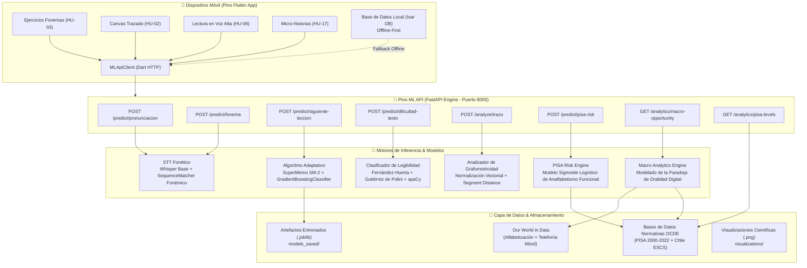

# 🏗️ Infraestructura y Arquitectura Completa de Machine Learning para Pino

> **Ubicación del Sistema:** `/home/zenith/Escritorio/Pino 2`  
> **Versión del Core:** `0.2.0-pisa-production`  
> **Frameworks:** FastAPI, PyTorch, Whisper, spaCy (`es_core_news_md`), Scikit-Learn, Pandas, NumPy, Joblib  

---

## 1. Diagrama de Arquitectura Global



---

## 2. Formulaciones Matemáticas y Modelos Teóricos

### 2.1 Algoritmo Adaptativo: SuperMemo SM-2 Adaptado
El algoritmo calcula el intervalo de revisión $I$ en días y el factor de facilidad $EF$ (Easiness Factor):

$$EF' = \max\left(1.3, \; EF + \left(0.1 - (5 - q) \cdot (0.08 + (5 - q) \cdot 0.02)\right)\right)$$

Donde $q \in \{0, 1, 2, 3, 4, 5\}$ es la calidad de la respuesta pedagógica:
- Acierto fluido sin titubeo: $q = 5$
- Acierto con duda/latencia: $q = 4$
- Error leve (fonema cercano): $q = 3$
- Fallo directo: $q = 2$

El intervalo entre sesiones consecutivas se calcula recursivamente:
$$I(n) = \begin{cases} 
1 & \text{si } n = 1 \\ 
6 & \text{si } n = 2 \\ 
\text{round}(I(n-1) \cdot EF') & \text{si } n > 2 
\end{cases}$$

Adicionalmente, se entrena un `GradientBoostingClassifier` sobre la matriz de features para predecir la probabilidad condicional de fallo $P(\text{error} \mid \text{features})$, optimizando la selección del ítem cuando existen múltiples candidatos en la ventana de repaso.

---

### 2.2 Analizador de Trazos y Distancia a Segmentos
Dada la polilínea del trazo del usuario $U = \{u_1, u_2, \dots, u_m\} \subset \mathbb{R}^2$ y el conjunto de segmentos ideales normalizados escalados al canvas $S = \{(a_k, b_k)\}_{k=1}^K$:

Para cada punto $u_i \in U$, su distancia ortogonal al segmento $(a_k, b_k)$ es:
$$\text{dist}(u_i, (a_k, b_k)) = \|u_i - (a_k + t^* (b_k - a_k))\|_2$$
Donde el parámetro de proyección escalar restringido $t^*$ es:
$$t^* = \text{clip}\left(\frac{(u_i - a_k) \cdot (b_k - a_k)}{\|b_k - a_k\|_2^2}, \; 0, \; 1\right)$$

La distancia mínima del punto a la letra completa es:
$$d(u_i) = \min_{1 \le k \le K} \text{dist}(u_i, (a_k, b_k))$$

Métricas clave computadas:
- **Desviación Promedio:** $\bar{d} = \frac{1}{m} \sum_{i=1}^m d(u_i)$
- **Porcentaje Dentro de Margen:** $P_{\text{margen}} = \frac{1}{m} \sum_{i=1}^m \mathbb{I}(d(u_i) \le M_{\text{tol}})$
- **Cobertura de la Letra:** Muestreo de $N$ puntos equidistantes en $S$ y cálculo de la fracción que tiene al menos un punto $u \in U$ a distancia $\le M_{\text{tol}}$.

---

### 2.3 Clasificador de Legibilidad y Dificultad Textual

#### A. Índice de Fernández-Huerta (Adaptación para la Lengua Española)
$$L = 206.84 - 0.60 \cdot P - 1.02 \cdot F$$
Donde:
- $P = \frac{\text{Total de Sílabas}}{\text{Total de Palabras}} \times 100$ (Densidad silábica por cada 100 palabras).
- $F = \frac{\text{Total de Palabras}}{\text{Total de Oraciones}}$ (Longitud media oracional).

Escala de interpretación:
- $L \ge 90$: Muy fácil (Nivel 1 Pino / Pre-lector)
- $80 \le L < 90$: Fácil (Nivel 2 Pino / Lector Silábico)
- $65 \le L < 80$: Dificultad media (Nivel 3 Pino / Frases compuestas)
- $50 \le L < 65$: Difícil (Nivel 4 Pino / Párrafos cotidianos)
- $L < 50$: Muy difícil (Nivel 5 Pino / Nivel PISA Avanzado)

#### B. Índice de Gutiérrez de Polini
$$I_{GP} = 95.2 - 9.7 \cdot \left(\frac{\text{Letras}}{\text{Palabras}}\right) - 0.35 \cdot \left(\frac{\text{Palabras}}{\text{Oraciones}}\right)$$

---

### 2.4 Motor de Predicción de Riesgo PISA y Analfabetismo Funcional

El modelo predice el rendimiento en la escala PISA mediante un **Índice Compuesto de Automatización Lectora (ICAL)**:
$$\text{ICAL} = 0.35 \cdot S_{\text{fon}} + 0.30 \cdot S_{\text{flu}} + 0.20 \cdot S_{\text{gra}} + 0.15 \cdot S_{\text{adh}}$$

Donde cada sub-puntaje ($0$ a $100$) sintetiza una dimensión cognitiva:
- $S_{\text{fon}}$: Precisión en fonemas, discriminación de pares mínimos y penalización por WER.
- $S_{\text{flu}}$: Fluidez oral (WPM normalizado a 60 palabras/minuto) y velocidad de respuesta.
- $S_{\text{gra}}$: Cobertura del trazo y control de temblor motor fino.
- $S_{\text{adh}}$: Regularidad en el uso y resistencia al olvido espaciado.

El puntaje proyectado en la escala PISA se define mediante transformación lineal calibrada con la distribución empírica de Chile y la OCDE:
$$\hat{Y}_{\text{PISA}} = 280.0 + \left(\frac{\text{ICAL}}{100}\right) \cdot 270.0$$

La probabilidad de encontrarse en condición de **analfabetismo funcional** (bajo el Nivel 2 de PISA, $< 407$ puntos) se calcula mediante función sigmoide logística centrada en el umbral normativo:
$$P(\text{Bajo Nivel 2}) = \frac{1}{1 + \exp\left(-\frac{407.0 - \hat{Y}_{\text{PISA}}}{\sigma}\right)}, \quad \sigma = 25.0$$

---

### 2.5 Modelado de la Paradoja de la Digitalización Oral
Se define el **Índice de Brecha de Oralidad Digital ($DOPI$)**:
$$DOPI = \text{Suscripciones Móviles por 100 hab} - \text{Tasa de Alfabetización Formal}$$

El **Índice de Oportunidad de Mercado e Impacto ($IOP$)**:
$$IOP = 0.45 \cdot \text{clip}(DOPI \times 1.2, 0, 100) + 0.35 \cdot \text{Urgencia Educativa} + 0.20 \cdot \text{clip}(\text{Móviles}, 0, 100)$$

---

## 3. Especificación de Endpoints y Contratos de la API

| Endpoint | Método | Payload | Respuesta |
| :--- | :---: | :--- | :--- |
| `/predict/pronunciacion` | `POST` | Multipart: `file` (audio), `texto_esperado` (form) | `ResultadoPronunciacionSchema`: puntaje global, WER, CER, sílabas correctas/incorrectas |
| `/predict/fonema` | `POST` | Multipart: `file` (audio), `fonema_esperado` (form) | `ResultadoFonemaSchema`: correcto (bool), confianza (0-1) |
| `/predict/siguiente-leccion` | `POST` | JSON: `SiguienteLeccionRequest` (historial, modo, nivel) | `SiguienteLeccionResponse`: siguiente_item_id, tipo, p_error, desbloqueo |
| `/predict/dificultad-texto` | `POST` | JSON: `DificultadTextoRequest` (texto, nivel_objetivo) | `DificultadTextoResponse`: nivel (1-5), legibilidad FH, Gutiérrez, nivel PISA |
| `/analyze/trazo` | `POST` | JSON: `TrazoRequest` (puntos, letra, tolerancia, canvas) | `TrazoResponse`: desviación, cobertura %, velocidad, veredicto |
| `/predict/pisa-risk` | `POST` | JSON: `PisaRiskRequest` (telemetría acierto, latencia, WPM, trazo) | `PisaRiskResponse`: puntaje PISA estimado, probabilidad bajo Nivel 2, cuello de botella |
| `/analytics/pisa-history` | `GET` | Query param: `country` (default: "Chile") | Serie temporal 2000-2022 de puntajes en Lectura |
| `/analytics/pisa-levels` | `GET` | Query param: `country` (opcional) | Distribución de niveles de competencia 1c a 6 |
| `/analytics/chile-socioeconomic`| `GET` | Ninguno | Gradiente ESCS, dependencia municipal/subvencionado/pagado y zonas |
| `/analytics/macro-opportunity` | `GET` | Query param: `top_n` (default: 15) | Ranking mundial ordenado por Índice de Oportunidad de Oralidad |
| `/health` | `GET` | Ninguno | Estado de salud, versiones y checklist de modelos en memoria |

---

## 4. Guía de Ejecución y Pruebas

### Ejecución de Pruebas Unitarias
```bash
PYTHONPATH="src:/home/zenith/Proyectos/Pino/pino-ml/.venv/lib/python3.14/site-packages" python3 -m pytest tests/ -v
```

### Ejecución del Servidor Inferencia
```bash
./scripts/start_api.sh
```
O manualmente:
```bash
PYTHONPATH="src:/home/zenith/Proyectos/Pino/pino-ml/.venv/lib/python3.14/site-packages" python3 -m uvicorn pino_ml.api.main:app --host 0.0.0.0 --port 8000 --reload
```

### Re-entrenamiento de Modelos y Re-generación de Gráficos
```bash
# Descargar datos y compilar PISA
PYTHONPATH="/home/zenith/Proyectos/Pino/pino-ml/.venv/lib/python3.14/site-packages" python3 scripts/download_and_prepare_datasets.py

# Generar los 9 gráficos científicos
PYTHONPATH="/home/zenith/Proyectos/Pino/pino-ml/.venv/lib/python3.14/site-packages" python3 scripts/run_eda_colab_and_pisa.py

# Entrenar modelo predictivo adaptativo
PYTHONPATH="src:/home/zenith/Proyectos/Pino/pino-ml/.venv/lib/python3.14/site-packages" python3 src/pino_ml/pipelines/training_pipeline.py
```
