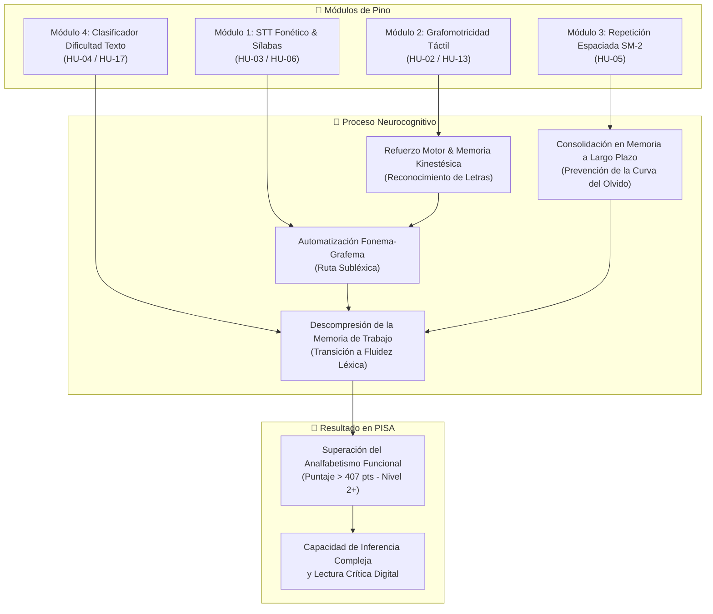

# 🌍 Estudio Integral de las Pruebas PISA en Chile y el Mundo: Fundamentación Técnica, Psicométrica y Neurocognitiva para Pino

> **Fuentes Oficiales:** OCDE (*PISA 2022 Results: Volumes I & II*), Agencia de Calidad de la Educación de Chile, UNESCO, Banco Mundial.  
> **Área de Estudio:** Competencia Lectora (*Reading Literacy*), Analfabetismo Funcional, Gradiente Socioeconómico y Arquitectura Cognitiva de Aprendizaje.  

---

## 1. El Marco PISA de la OCDE y la Definición de Competencia Lectora

El **Programa para la Evaluación Internacional de Estudiantes (PISA)** de la OCDE no evalúa la memorización mecánica de contenidos curriculares escolares; mide la capacidad de los jóvenes de 15 años para:
> *"Comprender, utilizar, evaluar, reflexionar y comprometerse con textos escritos para alcanzar metas individuales, desarrollar el conocimiento y potencial propios y participar plenamente en la sociedad."*

### 1.1 La Escala PISA y los Niveles de Competencia
La escala se fijó históricamente con una media de 500 puntos y una desviación estándar de 100 puntos en los países miembros de la OCDE. El rendimiento se clasifica en 6 niveles ordinales:

| Nivel | Rango Puntaje | Descripción Operativa de la Capacidad Lectora | Estatus de Alfabetización |
| :---: | :---: | :--- | :--- |
| **< 1c** | < 262 pts | Dificultad para decodificar palabras aisladas en frases breves. | **Analfabetismo Crítico / Pre-lector** |
| **1b** | 262 – 335 pts | Identifica información explícita trivial en oraciones extremadamente simples. | **Analfabetismo Funcional Severo** |
| **1a** | 335 – 407 pts | Localiza piezas de información literal directa sin distractores evidentes. | **Analfabetismo Funcional Moderado** |
| **2** | **407 – 480 pts** | **UMBRAL MÍNIMO DE COMPETENCIA FUNCIONAL.** Puede identificar la idea principal, inferencias directas y reconocer el propósito comunicativo. | **Alfabetización Funcional Básica** |
| **3** | 480 – 552 pts | Localiza e integra múltiples piezas de información independiente; realiza inferencias de complejidad media. | Competencia Intermedia |
| **4** | 552 – 625 pts | Comprende textos extensos con conceptos contraintuitivos; compara hipótesis textuales. | Competencia Avanzada |
| **5 y 6**| > 625 pts | Análisis crítico profundo, evaluación epistémica de fuentes, hipótesis complejas en textos no familiares. | Excelencia Lectora / Pensamiento Crítico |

> [!IMPORTANT]
> **El Nivel 2 (407 puntos) es la frontera mundial de la alfabetización funcional.**
> Un estudiante situado por debajo del Nivel 2 no puede comprender un contrato de trabajo simple, seguir el prospecto de un medicamento con instrucciones condicionales, ni discriminar información veraz frente a noticias falsas en entornos digitales.

---

## 2. Radiografía Empírica: Chile, la OCDE y América Latina

### 2.1 Puntajes Medios y Evolución Histórica (2000 – 2022)

```
  Puntaje PISA
   550 |                                            --- Singapur (543)
   500 |  =======================================   --- Promedio OCDE (476)
   450 |  -----------o---------o---------o-------   --- Chile (448) [Líder LatAm]
   400 |  .......................................   --- Promedio Latinoamérica (~410)
       +------------------------------------------------------------------------>
        2000       2006       2012       2018      2022 (Ciclo PISA)
```

- **Chile:** Obtuvo **448 puntos** en PISA 2022 (una variación marginal de -4 puntos respecto a los 452 de 2018, mostrando una notable resiliencia post-pandemia comparado con las caídas de hasta 20 puntos en países de Europa y Norteamérica).
- **Liderazgo Regional:** Chile encabeza consistentemente América Latina (superando a Uruguay con 430, México con 415, Brasil con 410, Colombia con 409 y Argentina con 401).
- **La Brecha con el Mundo Desarrollado:** A pesar de liderar la región, Chile se encuentra **28 puntos por debajo del promedio OCDE (476)** y a **95 puntos del líder mundial (Singapur con 543)**. En términos pedagógicos de la OCDE, una brecha de 20 a 25 puntos equivale a aproximadamente **un año lectivo completo de escolaridad**. Por lo tanto, el estudiante chileno promedio egresa con un rezago cognitivo de más de un año de escolaridad respecto a un estudiante finlandés, japonés o canadiense.

---

## 3. La Crisis del Analfabetismo Funcional (Porcentaje bajo el Nivel 2)

El mayor desafío no es el puntaje promedio, sino la proporción de la población que queda atrapada en los niveles inferiores:

```
Distribución Poblacional Bajo Nivel 2 en PISA 2022:
- Singapur:               11.0%
- Japón:                  13.5%
- Irlanda:                14.3%
- Finlandia:              21.4%
- Promedio OCDE:          26.3%  (~1 de cada 4 jóvenes)
- Chile:                  33.7%  (~1 de cada 3 jóvenes)
- Uruguay:                42.0%
- México:                 47.2%
- Brasil:                 50.2%
- Colombia:               51.1%
- Argentina:              54.4%
- Promedio Latinoamérica: 51.5%  (MÁS DE LA MITAD DE LA POBLACIÓN)
```

> [!CAUTION]
> **El estancamiento estructural de Chile:**
> En Chile, la cifra de estudiantes de 15 años por debajo del Nivel 2 se ha mantenido congelada en torno al **33% - 35% desde el año 2006**. A pesar del aumento presupuestario en educación, de la gratuidad universitaria y de reformas curriculares sucesivas, **un tercio de la juventud chilena es funcionalmente analfabeta**. En América Latina, la cifra supera el **50%**, configurando una catástrofe de capital humano.

---

## 4. El Gradiente Socioeconómico en Chile (Índice ESCS)

La Agencia de Calidad de la Educación y la OCDE analizan el rendimiento según el **Índice de Estatus Económico, Social y Cultural (ESCS)**:

### 4.1 Desglose por Cuartiles de Ingreso en Chile
| Cuartil Socioeconómico | Puntaje Medio PISA | % Bajo Nivel 2 (Analfabetismo Funcional) | % Nivel 2 o Superior | Brecha vs Cuartil 4 |
| :--- | :---: | :---: | :---: | :---: |
| **Cuartil 1 (Más vulnerable)** | 405 pts | **49.8%** | 50.2% | **-83 puntos** |
| **Cuartil 2 (Medio-bajo)** | 435 pts | **37.6%** | 62.4% | **-53 puntos** |
| **Cuartil 3 (Medio-alto)** | 461 pts | **27.4%** | 72.6% | **-27 puntos** |
| **Cuartil 4 (Mayor ingreso)** | 488 pts | **19.9%** | 80.1% | Referencia |

### 4.2 Desglose por Dependencia Administrativa
- **Colegios Municipales / SLEP (Públicos):** **418 puntos** (el **45.2%** está bajo el Nivel 2). Prácticamente la mitad de los egresados de la educación pública no comprende lo que lee.
- **Colegios Particulares Subvencionados:** **451 puntos** (el **31.9%** bajo Nivel 2).
- **Colegios Particulares Pagados (Privados):** **508 puntos** (solo el **11.2%** bajo Nivel 2, con un perfil idéntico al de los países nórdicos).

### 4.3 Desglose por Zona y Género
- **Urbano vs. Rural:** 450 pts (urbano) vs. 421 pts (rural). La brecha urbano-rural suma 29 puntos de desventaja (~1.2 años de escolaridad).
- **Brecha de Género:** Mujeres (457 pts) superan a Hombres (439 pts) por 18 puntos en competencia lectora, con un 37.4% de los varones en analfabetismo funcional frente al 30.2% de las mujeres.

---

## 5. Fundamentación Neurocognitiva: ¿Por qué las Fallas de PISA Nacen en la Decodificación Temprana?

¿Por qué jóvenes de 15 años que han asistido 10 años a la escuela no pueden responder preguntas de comprensión en PISA? La ciencia cognitiva del aprendizaje (*Cognitive Sciences & Reading Research*) ofrece una explicación irrefutable:

### 5.1 El Modelo Simple de Lectura (*Simple View of Reading* - Gough & Tunmer)
$$\text{Comprensión Lectora } (RC) = \text{Decodificación } (D) \times \text{Comprensión del Lenguaje Oral } (LC)$$

- Ambos factores operan como una **multiplicación estricta**, no como una suma. Si la decodificación $D$ es ineficiente o lenta, la comprensión lectora resultante tiende a cero, sin importar cuán rico sea el lenguaje oral del aprendiz.

### 5.2 El Modelo de Doble Ruta (*Dual-Route Model* - Coltheart)
Para leer eficientemente, el cerebro humano debe consolidar dos vías neuronales:
1. **Ruta Subléxica (Fonológica):** Traduce grafema por grafema a su sonido fonético. Es la ruta indispensable para aprender palabras nuevas y decodificar combinaciones silábicas no memorizadas.
2. **Ruta Léxica (Ortográfica/Visual):** Reconoce palabras familiares completas de manera instantánea y automatizada.

### 5.3 El Cuello de Botella de la Memoria de Trabajo (*Working Memory Saturation*)
- La capacidad de la **memoria de trabajo** (*working memory*) humana es estrictamente finita (puede retener aproximadamente 4 a 7 piezas de información simultáneas durante pocos segundos).
- Si un estudiante **no ha automatizado la correspondencia fonema-grafema** en los primeros años de vida (conciencia fonológica de sílabas directas, inversas y trabadas), se ve obligado a utilizar toda su energía cognitiva en descifrar mecánicamente cada palabra.
- **Consecuencia fatal:** Cuando llega al final del párrafo, ha saturado su memoria de trabajo descifrando letras sueltas y ya no le queda capacidad ejecutiva para realizar inferencias, relacionar premisas, o evaluar el tono argumentativo del texto (las habilidades que mide PISA).

### 5.4 El Efecto Mateo en la Lectura (*The Matthew Effect in Reading* - Stanovich)
> *"Los lectores ricos se vuelven más ricos; los lectores pobres se vuelven más pobres."*
- Quien automatiza temprano la fonética lee con fluidez y sin esfuerzo, disfruta la lectura, expande su vocabulario exponencialmente y rinde sobre 500 puntos en PISA.
- Quien tropieza en la fase fonológica experimenta fatiga, rechaza la lectura, su vocabulario se estanca y a los 15 años queda irremediablemente bajo el Nivel 2 de PISA.

---

## 6. Mapeo Directo: Cómo Pino Resuelve la Raíz del Problema

Cada uno de los 4 componentes del núcleo de **Pino** interviene quirúrgicamente en la cadena causal que desemboca en el fracaso de PISA:



1. **Discriminación Fonémica y Sílabas (HU-03/06):** Fortalece la conciencia fonológica y elimina la confusión de pares mínimos (/b/ vs /d/, /p/ vs /q/).
2. **Trazado de Letras (HU-02/13):** La neurociencia demuestra que escribir a mano (incluso sobre pantalla táctil) activa áreas motoras del córtex parietal y frontal que fijan la representación ortográfica de las letras mucho más rápido que solo mirar una pantalla.
3. **Repetición Espaciada SM-2 (HU-05):** Ataca la curva del olvido de Ebbinghaus, asegurando que los fonemas dominados se revisen en el momento exacto antes de ser olvidados.
4. **Dosificación de Dificultad Gradual (HU-04/17):** Garantiza que el usuario solo enfrente textos que coinciden con su nivel de legibilidad (índice Fernández-Huerta), evitando la frustración y la deserción escolar.
