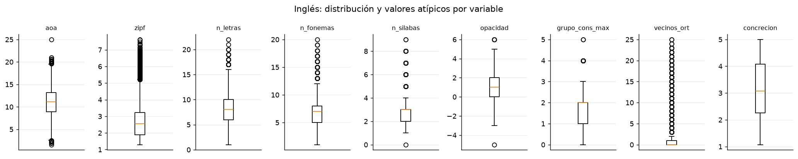
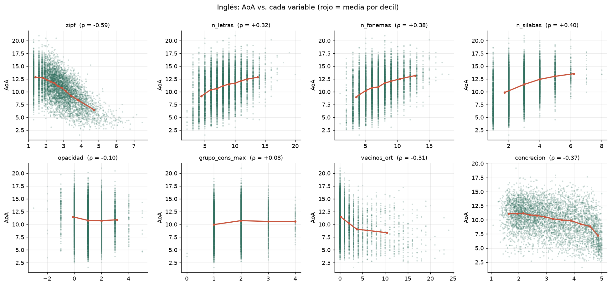
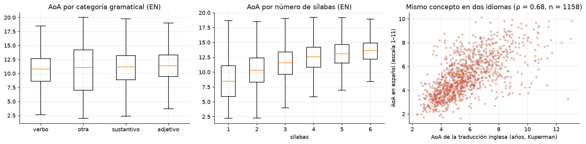
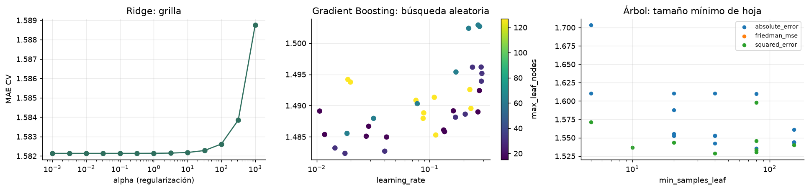
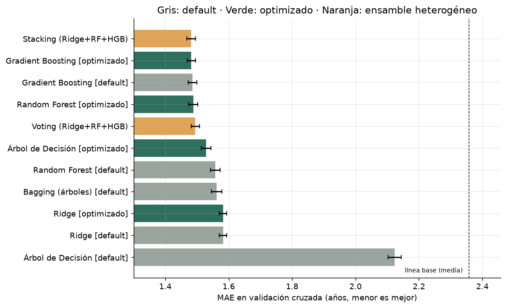
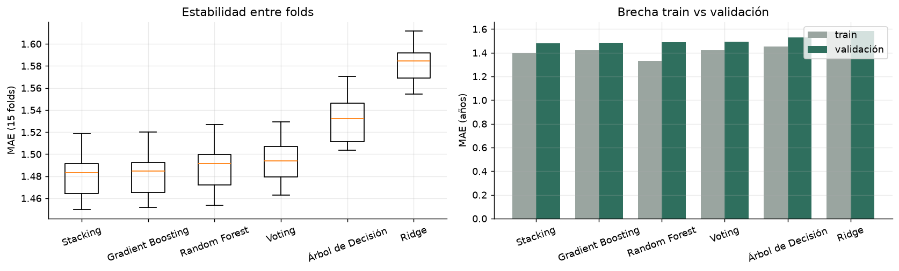
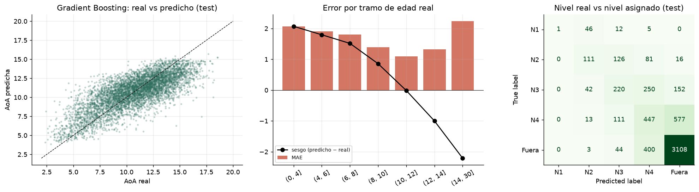
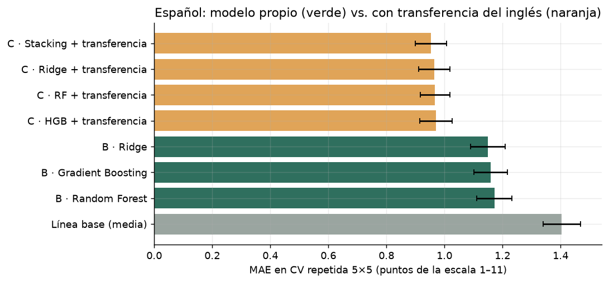
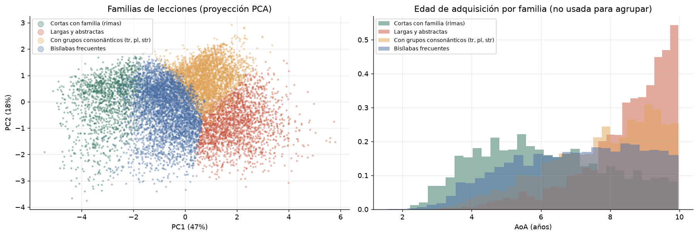
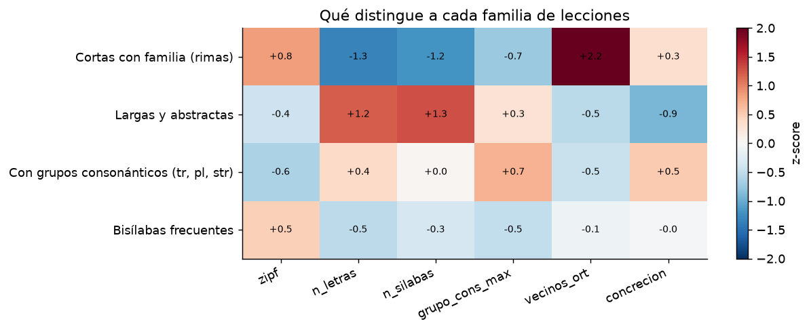

# Pino · ¿A qué edad se aprende cada palabra?

**Modelo de dificultad léxica para nivelar el vocabulario infantil en español e inglés**

Evaluación Final Transversal · MLY1101 Machine Learning · Informe técnico

> **Resultado en una línea:** un **Gradient Boosting** estima la edad de adquisición de cualquier palabra inglesa con un error medio de **1,50 años** (R² = 0,58) y la ubica en el nivel correcto de Pino, o a un nivel de distancia, en el **94 %** de los casos. Combinado con el conocimiento del inglés, en español alcanza una correlación de **ρ = 0,71** con las normas reales. El resultado es un dataset de **1.312 palabras en español** y **10.333 en inglés** niveladas por edad, con sílabas, fonemas e imágenes, listo para la app.

---

## Índice
1. [Descripción del problema de negocio](#1-descripción-del-problema-de-negocio)
2. [Objetivos del proyecto](#2-objetivos-del-proyecto)
3. [KPIs](#3-kpis)
4. [Fuentes de datos](#4-fuentes-de-datos)
5. [Metodología CRISP-DM](#5-metodología-crisp-dm)
6. [Preparación y análisis exploratorio (EDA)](#6-preparación-y-análisis-exploratorio-eda)
7. [Desarrollo de los modelos, optimización y ensambles](#7-desarrollo-de-los-modelos-optimización-y-ensambles)
8. [Evaluación de resultados](#8-evaluación-de-resultados)
9. [Conclusiones, limitaciones y recomendaciones](#9-conclusiones-limitaciones-y-recomendaciones)
10. [Reproducibilidad y estructura del proyecto](#10-reproducibilidad-y-estructura-del-proyecto)

---

## 1. Descripción del problema de negocio

**Pino** es una app móvil de alfabetización para niños pequeños (y adultos). Enseña con fonemas, sílabas, trazado de letras, imágenes y audio, funciona sin conexión y ahora se amplía para enseñar **español e inglés**. Cada lección se construye con **palabras**, y el orden en que aparecen define si funciona: una palabra demasiado difícil para la edad frustra al niño y una demasiado fácil lo aburre.

Hoy la nivelación la hacen a mano educadoras que revisan palabra por palabra. El proceso:
* **no escala**: el catálogo bilingüe tendrá miles de palabras;
* **es inconsistente** entre personas;
* **no tiene datos para el español**: las normas científicas de *edad de adquisición* (AoA) cubren una parte pequeña del vocabulario.

**Problema analítico:** estimar la **edad de adquisición (AoA)**, en años, de cualquier palabra a partir de propiedades que se calculan automáticamente. Es un problema de **regresión supervisada**. La predicción se traduce en **niveles de la app**:

| Nivel | AoA | Uso en la app |
|---|---|---|
| 1 · Primeras palabras | < 4 años | Vocabulario oral, imagen + audio |
| 2 · Preescolar | 4 – 5,9 | Sílabas directas (CV), conciencia fonológica |
| 3 · Lectura inicial | 6 – 7,9 | Decodificación de palabras completas |
| 4 · Lector en desarrollo | 8 – 9,9 | Palabras largas y menos frecuentes |

> **Nota sobre el cambio de enfoque.** En una versión anterior el proyecto buscaba predecir el abandono de aprendices con telemetría **simulada**, porque la app todavía no tiene usuarios. Se reemplazó por este problema porque usa **datos reales**, ataca el **núcleo del producto** (el contenido), escala al inglés y **no involucra datos personales de menores**. El detalle está en `presentacion/Pino_EFT.pptx`.

## 2. Objetivos del proyecto

1. Construir un modelo que estime la AoA de palabras en inglés con **capacidad de generalización comprobada**.
2. Evaluar si el modelo se **transfiere al español** y construir un modelo propio para el español.
3. Traducir la estimación en **niveles de la app** y entregar un **dataset de vocabulario infantil bilingüe**.
4. Descubrir **familias de lecciones** con aprendizaje no supervisado.
5. Analizar **sesgos, limitaciones y riesgos éticos** antes de usar el modelo con niños.

## 3. KPIs

| Tipo | KPI | Meta | Resultado | |
|---|---|---|---|---|
| Modelo (EN) | MAE en test | ≤ 1,6 años | **1,50** años | ✅ |
| Modelo (EN) | R² en test | ≥ 0,55 | **0,58** | ✅ |
| Modelo (EN) | Spearman (orden de enseñanza) | ≥ 0,75 | **0,74** | ❌ |
| Generalización | Brecha de MAE train – validación | ≤ 0,30 años | **0,06** años | ✅ |
| Negocio | Nivel correcto ± 1 | ≥ 90 % | **94,3 %** | ✅ |
| Negocio | Error grave (palabra de ≥ 10 años en nivel < 6 años) | ≤ 2 % | **0,05 %** | ✅ |
| Transferencia (ES) | Spearman con normas españolas, mejor estrategia | ≥ 0,60 | **0,71** | ✅ |
| Transferencia (ES) | Spearman *zero-shot* (modelo inglés sin datos españoles) | ≥ 0,60 | **0,53** | ❌ |
| Producto | Palabras infantiles niveladas por idioma | ≥ 1.000 | **1.312** ES / **10.333** EN | ✅ |

La correlación de Spearman en inglés queda levemente bajo la meta. La transferencia directa al español, sin ningún dato español, no alcanza la meta; por eso se usa la estrategia combinada (§8.4). Los KPIs de negocio (nivel ±1 y error grave) se cumplen con holgura.

## 4. Fuentes de datos

Todas las fuentes son **reales, públicas y citables**. Las crudas están en `data/raw/`.

| Archivo | Fuente | Contenido | Uso |
|---|---|---|---|
| `en_kuperman2012_aoa_51715.xlsx` | Kuperman, Stadthagen-González y Brysbaert (2012). *Behavior Research Methods*, 44, 978–990 | AoA (años) de 30.121 palabras, más frecuencia SUBTLEX-US, letras, fonemas, sílabas y categoría | **Objetivo** y variables (EN) |
| `en_brysbaert2014_concreteness.xlsx` | Brysbaert, Warriner y Kuperman (2014). *BRM*, 46, 904–911 | Concreción (1–5) de 39.954 palabras | Variable |
| `en_cmudict.dict` | CMU Pronouncing Dictionary (BSD) | Pronunciación ARPAbet | Grupos consonánticos, fonemas |
| `es_alonso2015_aoa_norare.tsv` | Alonso, Fernández y Díez (2015). *BRM*, 47, 268–274, vía NoRaRe/Concepticon (CC-BY) | AoA (escala 1–11) de 1.239 palabras vinculadas a su concepto en inglés | **Objetivo** (ES) |
| `es_subtlex_esp_cuetos2011.xlsx` | Cuetos, Glez-Nosti, Barbón y Brysbaert (2011). *Psicológica*, 32 | Frecuencia de 94.000 formas | Variable (ES) |
| `multipic_dunabeitia2022.csv` | Duñabeitia et al. (2022). *QJEP* (CC-BY) | 500 dibujos con su nombre en 30 idiomas | Pares imagen–palabra |
| `es_alonso2016_*`, `es_guasch2016_*` | Alonso et al. (2016); Guasch et al. (2016) | Verbos y normas semánticas | Contraste |

El catálogo completo de datasets útiles para la app (Wordbank, CHILDES, EsPal, LEXIN, Dolch/Fry, etc.) y su relación con los **métodos de enseñanza** (silábico, fonético, *synthetic phonics*, *word families*, *sight words*) está en [`docs/DATASETS_Y_METODOS_ENSENANZA.md`](docs/DATASETS_Y_METODOS_ENSENANZA.md).

### 4.1 Herramientas colaborativas y de desarrollo

| Herramienta | Para qué se usó | Por qué sirve a este problema |
|---|---|---|
| **Git + GitHub** (`Zenith-AB/pino-app`) | Versiones, ramas y revisión de cambios del equipo | Historial de quién cambió qué; se revisa antes de integrar y se puede volver a una versión anterior del modelo |
| **Jupyter** | Análisis reproducible con código, gráficos y explicación | Cada etapa se ejecuta y verifica en orden |
| **Python** (pandas, NumPy, SciPy, scikit-learn, matplotlib) | Preparación, modelado, pruebas estadísticas y gráficos | `Pipeline` evita fuga de información y el mismo objeto se usa en la app |
| **`venv` + versiones fijas** | Mismo entorno en todos los equipos | Los modelos `.joblib` dependen de la versión de scikit-learn |
| **joblib + `metricas.json`** | Compartir modelos y resultados entre notebook y app | La app muestra las cifras de la última ejecución |
| **Streamlit** | Demo para educadoras | Permite recoger retroalimentación sin programar |

## 5. Metodología CRISP-DM

| Fase | Qué se hizo | Dónde |
|---|---|---|
| 1. Comprensión del negocio | Problema de nivelación, objetivos, KPIs, niveles de la app | §1–3, notebook §1 |
| 2. Comprensión de los datos | Fuentes, calidad, anomalías, EDA bivariado y bilingüe | §4, §6, notebook §2 |
| 3. Preparación | Variables psicolingüísticas iguales para ambos idiomas, filtro de calidad, split estratificado, `Pipeline` sin fuga de información | §6, `src/lexico.py`, notebook §3 |
| 4. Modelado | 2 modelos base (Ridge, Árbol) + 5 ensambles (Bagging, RF, Gradient Boosting, Voting, Stacking), con optimización de hiperparámetros | §7, notebook §4 |
| 5. Evaluación | CV repetida, *t*-test corregido, *learning curve*, test con IC bootstrap, métricas de negocio, transferencia al español | §8, notebook §5–6 |
| 6. Despliegue | K-Means de familias de lecciones, dataset de vocabulario, modelos serializados, app Streamlit y plan de monitoreo | §9, notebook §7 y §9 |

CRISP-DM es **iterativo** y así se aplicó:
* **Comprensión del negocio → datos:** el enfoque inicial (abandono de aprendices con telemetría simulada) se descartó al revisar los datos disponibles.
* **Despliegue → preparación:** la primera ejecución sugirió *beer* o *gun* como palabras fáciles; se agregó el filtro editorial.
* **Monitoreo propuesto:** medir qué porcentaje de niveles corrigen las educadoras (re-entrenar si supera 20 %) y el error en palabras nuevas.

## 6. Preparación y análisis exploratorio (EDA)

### 6.1 Variables
Calculadas en `src/lexico.py` **con la misma definición para inglés y español**. En español, sílabas y fonemas se obtienen con `src/texto_es.py`, copia del módulo `pino_ml.utils.texto_es` del backend, incluida para que la carpeta se ejecute sola.

**Estructuras de datos en Python** (notebook §2): diccionario para las pronunciaciones (búsqueda O(1)), conjuntos para vocales y vocabulario, `Counter` de patrones `c*sa` para contar vecinos sin comparar todas las palabras entre sí, y `DataFrame` con operaciones vectorizadas. Un **contrato de datos** (`validar`) detiene la ejecución si una fuente llega con columnas faltantes, valores fuera de rango o duplicados.

| Variable | Definición | Por qué importa |
|---|---|---|
| `zipf` | log₁₀(frecuencia por millón) + 3 | Lo que más se oye se aprende antes |
| `n_letras`, `n_fonemas`, `n_silabas` | Longitud | Carga de memoria de trabajo |
| `opacidad` | letras − fonemas | Costo de decodificación: casi 0 en español, alto en inglés |
| `grupo_cons_max` | Máxima secuencia de consonantes (*str*) | Dificultad articulatoria |
| `vecinos_ort` | Vecindario de Coltheart (palabras a una letra) | Base del método de *word families* |
| `concrecion` | 1 abstracta – 5 concreta | Lo que se puede dibujar se aprende antes |
| `categoria` | sustantivo / verbo / adjetivo / otra | A igual frecuencia, los adjetivos se adquieren algo más tarde |
| `complejidad_silabica` (ES) | Media de la complejidad de las sílabas (CV = 1 … CCVC = 3) | Método silábico |

### 6.2 Calidad de datos
* Concreción nula en ~23 % (EN) y `grupo_cons_max` nulo en ~25 % (EN), porque son formas flexionadas que no aparecen en Brysbaert ni en CMU → **imputación con mediana + indicador de ausencia**.
* Se excluyen 2.278 palabras que menos del 50 % de los evaluadores conocía (AoA poco confiable). Quedan **28.825 palabras** en inglés.
* Sin duplicados. En español, las categorías de NoRaRe tienen errores puntuales (*vino* = verbo).

**Anomalías y valores atípicos** (regla 1,5 × IQR y revisiones lógicas):

| Anomalía | Magnitud | Decisión |
|---|---|---|
| Atípicos en vecinos ortográficos y sílabas | 14,8 % y 8,1 % | Se mantienen: son colas reales (palabras muy largas o con muchos vecinos) |
| Atípicos en AoA, letras, fonemas, concreción, opacidad | ≤ 2,2 % | Se mantienen |
| Palabra con 0 sílabas (*frays*) | 1 | Error de la fuente; sin efecto práctico |
| AoA < 3 años | 43 palabras | Válidas y escasas; explican el error en el nivel 1 |
| Poco conocidas (< 50 %) | 2.278 | **Se excluyen** |
| Categoría dudosa en español (*vino* = verbo) | casos aislados | Se documenta |

**Prueba de sensibilidad:** quitar los atípicos del entrenamiento (23,8 % de las filas) **empeora** el MAE de validación (Ridge 1,582 → 1,604; Gradient Boosting 1,486 → 1,513). Por eso no se eliminan.



### 6.3 Hallazgos principales



1. **La frecuencia es la señal más fuerte** (ρ ≈ −0,59) y su relación con la AoA **no es lineal**.
2. **Concreción** (ρ ≈ −0,37): *perro* antes que *justicia*.
3. **Longitud y sílabas** aumentan la AoA y son **colineales** entre sí (ρ ≈ 0,9).
4. Las palabras con **muchos vecinos** (*cat, hat, bat*) se aprenden antes.
5. **El concepto se transfiere entre idiomas:** la AoA española y la de la traducción inglesa correlacionan ρ ≈ 0,68.
6. A igual frecuencia, los **adjetivos** se aprenden algo más tarde que sustantivos y verbos.
7. El objetivo es continuo (media ≈ 11 años). Solo ~17 % de las palabras tiene AoA < 8 años, y en ese tramo se concentra el interés del negocio.



### 6.4 Transformaciones
* **Split 80/20 estratificado por nivel** (train 23.060, test 5.765). El test no se usa hasta la evaluación final.
* `Pipeline` de scikit-learn: imputación (mediana + indicador), `StandardScaler` y `OneHotEncoder`. Se ajusta **dentro de cada fold**, sin fuga de información.
* Los datos procesados se guardan en `data/processed/palabras_en_modelado.csv` y `palabras_es_modelado.csv`.

## 7. Desarrollo de los modelos, optimización y ensambles

### 7.1 Modelos
| Tipo | Modelo | Rol |
|---|---|---|
| Línea base | `DummyRegressor` (media) | Piso de comparación |
| Supervisado base | **Ridge** (lineal regularizado) | Interpretable, robusto a colinealidad |
| Supervisado base | **Árbol de Decisión** | No lineal |
| Ensamble (bagging) | **Bagging** de árboles, **Random Forest** | Reducen varianza |
| Ensamble (boosting) | **Gradient Boosting** (`HistGradientBoostingRegressor`) | Reduce sesgo de forma secuencial |
| Ensamble heterogéneo | **Voting** y **Stacking** (Ridge + RF + GB, meta-modelo Ridge) | Combina familias distintas |
| No supervisado | **K-Means** (+ PCA para visualizar) | Familias de lecciones |

**Por qué estos algoritmos**

| Algoritmo | Motivo de selección | Qué se configura |
|---|---|---|
| Ridge | Referencia interpretable; L2 estabiliza variables colineales | `alpha` |
| Árbol de Decisión | No linealidades e interacciones; base para medir el aporte de ensamblar | profundidad, hoja mínima, criterio |
| Bagging / Random Forest | Bajan la varianza promediando árboles distintos | árboles, `max_features`, `max_samples`, profundidad |
| Gradient Boosting (histogramas) | Baja el sesgo, rápido con ~23.000 filas, *early stopping* | `learning_rate`, iteraciones, hojas, L2 |
| Voting / Stacking | Combinan familias distintas | modelos base y meta-modelo |

Se descartaron SVR (costo cuadrático con 23.000 filas), k-NN (sensible a variables redundantes y lento al predecir) y redes neuronales (pocas variables tabulares).

### 7.2 Optimización de hiperparámetros
Validación cruzada de 5 folds sobre *train*, optimizando **MAE** (error en años, fácil de explicar a las educadoras).

| Modelo | Estrategia | Mejores hiperparámetros |
|---|---|---|
| Ridge | `GridSearchCV`, 13 valores de `alpha` | `alpha=0.001` |
| Árbol | `RandomizedSearchCV`, 40 iteraciones | `min_samples_leaf=40`, `max_depth=10`, `criterion=squared_error` |
| Random Forest | `RandomizedSearchCV`, 15 iteraciones | `n_estimators=400`, `min_samples_leaf=5`, `max_samples=0.7`, `max_features=0.5`, `max_depth=12` |
| Gradient Boosting | `RandomizedSearchCV`, 35 iteraciones, `learning_rate` log-uniforme, *early stopping* | `l2_regularization=0`, `learning_rate=0.0178`, `loss=squared_error`, `max_depth=None`, `max_features=0.5`, `max_iter=1200`, `max_leaf_nodes=31`, `min_samples_leaf=20` |



**Efecto de la optimización:**
* **Árbol de decisión:** por defecto memoriza (MAE de train ≈ 0,06 y validación 2,12). Al limitar la profundidad y exigir hojas grandes, el MAE de validación **baja 0,59 años** y la brecha cae de 2,06 a 0,08 años. Es la mayor ganancia.
* **Random Forest:** la brecha baja de 0,95 a 0,16 años y el MAE ~0,07 años.
* **Gradient Boosting:** la configuración por defecto ya era buena y la búsqueda solo la mejora levemente. No todo modelo gana mucho con la optimización, y es importante reportarlo.
* **Ridge:** no mejora. El mejor `alpha` queda en el borde inferior de la grilla, lo que indica que no necesita regularización: su error es de **sesgo** (no capta la curvatura de la frecuencia), no de varianza.

### 7.3 Ensambles y su aporte



| Comparación (MAE en CV, años) | Referencia | Ensamble | Mejora |
|---|---|---|---|
| Bagging vs. un árbol | 2,123 | 1,562 | **0,562 (26 %)** |
| Random Forest vs. árbol optimizado | 1,529 | 1,488 | 0,041 (2,7 %) |
| Gradient Boosting vs. árbol optimizado | 1,529 | 1,482 | 0,046 (3,0 %) |
| Gradient Boosting vs. Ridge | 1,582 | 1,482 | **0,100 (6,3 %)** |
| Voting vs. Gradient Boosting | 1,482 | 1,495 | −0,012 |
| Stacking vs. Gradient Boosting | 1,482 | 1,481 | +0,001 |

* **Bagging:** promediar 100 árboles sin podar baja el MAE de 2,12 (un árbol) a 1,56. Es la demostración directa de que el ensamble **reduce la varianza**.
* **Random Forest / Gradient Boosting optimizados** superan a Ridge por ~0,10 años y a la línea base por ~0,87 años.
* **Voting y Stacking aportan poco** porque los errores de RF y Gradient Boosting correlacionan ≈ 0,99: se equivocan en las mismas palabras. El error restante viene del **ruido de la norma** (juicios subjetivos) y del significado de la palabra, no del algoritmo.

## 8. Evaluación de resultados

### 8.1 Generalización: CV repetida 5 × 3 (15 estimaciones por modelo)

| Modelo | MAE (media ± d.e.) | R² | Brecha train–val | Tiempo de ajuste (s) |
|---|---|---|---|---|
| Stacking | 1,481 ± 0,019 | 0,582 | 0,081 | 39,83 |
| Gradient Boosting | 1,482 ± 0,018 | 0,581 | 0,062 | 1,66 |
| Random Forest | 1,488 ± 0,020 | 0,578 | 0,157 | 5,68 |
| Voting | 1,495 ± 0,018 | 0,577 | 0,073 | 7,52 |
| Árbol de Decisión | 1,531 ± 0,021 | 0,552 | 0,078 | 0,08 |
| Ridge | 1,582 ± 0,017 | 0,530 | 0,001 | 0,04 |



* Todas las brechas son < 0,30 años, sin sobreajuste relevante. La *learning curve* (`images/08_learning_curve.png`) muestra curvas de train y validación que convergen, así que **más datos del mismo tipo aportarían poco**. Para mejorar hacen falta **nuevas variables** (semánticas, de habla infantil).
* La desviación estándar entre folds es ~0,02 años: los resultados son estables.

### 8.2 Selección de la solución
El Stacking obtiene el menor MAE, pero solo **0,001 años** (≈ 9 horas) mejor que Gradient Boosting. El *t*-test corregido de Nadeau-Bengio la marca como "significativa" porque con 23.000 palabras cualquier diferencia lo es, pero **no tiene relevancia práctica**. Se aplicó la regla definida de antemano: entre los modelos a menos de 0,02 años del mejor y con brecha ≤ 0,30, se elige el **más simple**.

**Solución elegida: Gradient Boosting**, que tiene:
* el mismo error que el Stacking en la práctica;
* un entrenamiento **~24 veces más rápido** (1,7 s contra 39,8 s por ajuste), y en producción hay que re-entrenar con cada nueva norma o idioma;
* un archivo **87 veces más liviano** (1,2 MB contra 104 MB), relevante para una app sin conexión;
* menos piezas que mantener (un modelo en vez de cuatro);
* una brecha de solo 0,06 años.

**Aporte a los objetivos del negocio**

| Criterio | Ridge | Random Forest | **Gradient Boosting** | Stacking |
|---|---|---|---|---|
| MAE test ≤ 1,6 | 1,609 ❌ | 1,510 | **1,501** | 1,501 |
| Nivel ±1 ≥ 90 % | 94,4 % | 94,5 % | **94,3 %** | 94,5 % |
| Error grave ≤ 2 % | 0,02 % | 0,02 % | **0,05 %** | 0,05 % |
| Tamaño | < 0,1 MB | 50,7 MB | **1,2 MB** | 103,9 MB |
| Interpretabilidad | alta | media | **media** | baja |

### 8.3 Test (palabras nunca vistas)

| Modelo | MAE | R² | Spearman | Nivel exacto | Nivel ±1 | Error grave |
|---|---|---|---|---|---|---|
| Ridge | 1,609 | 0,526 | 0,706 | 64,6 % | 94,4 % | 0,02 % |
| Random Forest | 1,510 | 0,577 | 0,735 | 67,4 % | 94,5 % | 0,02 % |
| Gradient Boosting ⭐ | 1,501 | 0,581 | 0,737 | 67,4 % | 94,3 % | 0,05 % |
| Stacking | 1,501 | 0,581 | 0,737 | 67,3 % | 94,5 % | 0,05 % |

El MAE de test (1,50 años, IC 95 % bootstrap [1,47; 1,53]) es casi igual al de CV (1,48): el modelo **generaliza**.



**Lectura del error:** el modelo **sobreestima** la AoA de las palabras más tempranas, que quedan 1–3 años "más tarde", y subestima las más tardías. Es regresión hacia la media. El sesgo va en **dirección segura**: casi nunca una palabra adulta cae en un nivel infantil (error grave 0,05 %). Como contrapartida, el **nivel 1 queda sub-poblado** por el modelo y conviene completarlo con listas de primeras palabras validadas (Wordbank/CDI).

**Importancia de variables** (permutación en test): la frecuencia domina, seguida de la concreción, la longitud y la categoría (`images/10_importancia.png`).

**Lectura de negocio por nivel** ([notebook complementario](notebooks/analisis_por_nivel.ipynb))

El 62 % de las palabras es "fuera de foco", así que las métricas de nivel hay que compararlas con **no usar modelo**:

| Métrica (test) | Sin modelo | Gradient Boosting | Con cortes calibrados |
|---|---|---|---|
| Nivel exacto | 61,7 % | **67,4 %** | 65,2 % |
| Nivel ±1 | 81,6 % | **94,3 %** | 94,2 % |
| Error grave | 0 % | 0,05 % | 0,14 % |
| Palabras infantiles: exacto | 0 % | 35,3 % | 37,0 % |
| Palabras infantiles: ±1 | 52,0 % | 87,4 % | 89,95 % |
| Recall del nivel 1 | 0 % | 1,6 % (1 de 64) | **37,5 %** |

* El aporte sobre no usar modelo es de **+5,8 puntos** en nivel exacto y **+12,8** en ±1. El 94 % por sí solo sobreestima el logro.
* Medido solo en palabras infantiles, el ±1 (87 %) **no llega** a la meta de 90 %.
* **Mejora probada:** cortar la predicción en 4,84 / 6,94 / 8,82 / 10,33 años (calibrado con predicciones *out-of-fold* del train) recupera el nivel 1 sin reentrenar. La idea surgió al revisar el test, así que conviene confirmarla con palabras nuevas. La app y el dataset siguen con los cortes fijos.

### 8.4 Español: tres estrategias (CV anidada 5 × 5, 1.239 palabras)

Los hiperparámetros se eligen en un CV **interno** de 3 folds (`GridSearchCV` en Ridge, `RandomizedSearchCV` en RF y Gradient Boosting) y el error se mide en el CV **externo**, así la optimización no infla el resultado.

| Estrategia | MAE (escala 1–11) | R² | Spearman | Brecha |
|---|---|---|---|---|
| Línea base (media) | 1,404 | 0,000 | — | — |
| B · Ridge | 1,149 | 0,296 | 0,550 | 0,018 |
| B · Random Forest | 1,172 | 0,275 | 0,525 | 0,229 |
| B · Gradient Boosting | 1,159 | 0,287 | 0,542 | 0,132 |
| C · Ridge + transferencia | 0,964 | 0,469 | 0,703 | 0,017 |
| C · RF + transferencia | 0,967 | 0,475 | 0,704 | 0,222 |
| C · HGB + transferencia | 0,971 | 0,472 | 0,699 | 0,147 |
| **C · Stacking + transferencia** | **0,953** | **0,486** | **0,709** | 0,114 |
| A · Transferencia directa (zero-shot) | — | — | 0,532 | — |

**Efecto de optimizar en español** (MAE por defecto → optimizado):

| Modelo | Solo español | Con transferencia |
|---|---|---|
| Ridge | 1,149 → 1,149 (sin cambio) | 0,964 → 0,964 (sin cambio) |
| Random Forest | 1,207 → 1,172 (p < 0,01) | 0,978 → 0,967 (no significativo) |
| Gradient Boosting | 1,263 → 1,159 (p < 0,001) | 1,023 → 0,971 (p < 0,001) |

La brecha train–validación de RF y Gradient Boosting cae de 0,59–0,76 a 0,13–0,23: optimizar **controla el sobreajuste**.

Hiperparámetros del modelo español final (Stacking): Ridge `alpha=0.01`; Random Forest `max_depth=6`, `max_features=0.7`, `min_samples_leaf=1`, `max_samples=None`; Gradient Boosting `learning_rate=0.026`, `max_iter=200`, `max_leaf_nodes=7`, `min_samples_leaf=20`, `l2_regularization=1`.



* **A · Zero-shot:** el modelo inglés aplicado al español conserva parte del orden (ρ = 0,53). Funciona, pero no alcanza la meta.
* **B · Modelo propio:** con solo 1.239 palabras, Ridge rinde igual o mejor que los ensambles incluso optimizados. Con pocos datos, el modelo simple gana.
* **C · Propio + transferencia:** agregar la AoA de la traducción inglesa y la predicción del modelo inglés reduce el MAE ~0,2 puntos (p < 0,001) y lleva la correlación a **ρ = 0,71**. Es un **stacking entre idiomas**: el conocimiento de 28.000 palabras inglesas compensa la escasez de datos españoles.
* La escala española 1–11 se convierte a años con **enlace equipercentil** sobre los conceptos con norma en ambos idiomas (`images/12_enlace_equipercentil.png`).

### 8.5 No supervisado: familias de lecciones (K-Means, k = 4)

K-Means sobre 11.565 palabras infantiles de ambos idiomas, con variables de forma y uso (frecuencia, letras, sílabas, grupos consonánticos, vecinos, concreción). La AoA **no** se usa para agrupar.

| Familia | Palabras | Uso pedagógico |
|---|---|---|
| Cortas con familia (rimas) | 1.523 | Word families y rimas; primeras decodificaciones |
| Largas y abstractas | 2.358 | Niveles 3–4; apoyo con audio |
| Con grupos consonánticos (tr, pl, str) | 3.534 | Sílabas trabadas; avanzar después de CV/CVC |
| Bisílabas frecuentes | 4.150 | Método silábico con sílabas directas |



**Elección de k y del algoritmo**

| k | Silueta | Davies-Bouldin | Estabilidad ARI (media / mín.) |
|---|---|---|---|
| 2 | 0,262 | 1,424 | 0,97 / 0,94 |
| 3 | 0,210 | 1,552 | 0,95 / 0,89 |
| **4** | 0,203 | 1,515 | **0,91 / 0,76** |
| 5 | 0,207 | 1,461 | 0,84 / 0,54 |
| 6 | 0,214 | 1,348 | 0,90 / 0,61 |
| 8 | 0,220 | 1,323 | 0,78 / 0,54 |

| Algoritmo (k = 4) | Silueta | Davies-Bouldin | Calinski-Harabasz |
|---|---|---|---|
| **K-Means** | **0,203** | **1,50** | **1.586** |
| Jerárquico (Ward) | 0,162 | 1,74 | 1.237 |
| Mezcla gaussiana | 0,035 | 3,56 | 754 |

La silueta es baja para todo *k*: las palabras forman un **continuo**, y las métricas internas **no señalan k = 4** por sí solas (la silueta prefiere 2, Davies-Bouldin 8). Se elige k = 4 porque es estable ante remuestreos (ARI medio 0,91), entrega suficientes familias para planificar lecciones (2 o 3 son más estables pero poco útiles) y K-Means supera a los otros algoritmos. Debe leerse como una **organización pedagógica**, no como grupos naturales.



La AoA media va de 6,1 a 8,5 años según la familia, aunque no se usó para agrupar. **Valor para el negocio:** sugiere un orden de lecciones (rimas → bisílabas frecuentes → grupos consonánticos → largas y abstractas) y permite armar cada lección con palabras de dificultad de lectura parecida, algo que la AoA sola no entrega.

### 8.6 Sesgos y desempeño por grupo
* El error absoluto es mayor en **sustantivos** (1,56) y palabras de **2–3 sílabas** (1,54–1,60). Los **verbos** tienen menor error pero el mayor sesgo (se subestiman 0,21 años). El R² cae a 0,27 en palabras **sin concreción**. Son candidatas a revisión manual.
* **Sesgo cultural medido:** ninguna de 10 palabras chilenas está en la norma española (7 de sus equivalentes de España sí) y el modelo les asigna **0,98 años más** al mismo concepto (*guagua* 5,3 y *bebé* 3,6). Es una muestra chica elegida a mano y parte de las palabras de España estuvo en el entrenamiento: la cifra es indicativa.
* **Sesgos de los datos:** las normas vienen de **adultos de EE. UU. y España**, no de niños chilenos, y falta vocabulario regional (*palta*, *polera*, *guagua*). La frecuencia viene de **subtítulos de películas**, no de habla dirigida a niños. En español, la concreción se toma de la **traducción inglesa**.
* **Contenido inapropiado:** la primera ejecución sugirió *beer*, *gun* y *murder* como palabras "fáciles", porque son frecuentes en películas. Se agregó un **filtro editorial** que excluye groserías, violencia, alcohol, drogas y sexualidad. Es una primera barrera; la revisión humana sigue siendo obligatoria.

### 8.7 Privacidad y consideraciones éticas

| Aspecto | Hoy | Si la app recoge datos de uso |
|---|---|---|
| Datos personales | Ninguno: normas agregadas por palabra | Aplican la **Ley 19.628** y su reforma, la **Ley 21.719** (vigencia desde el 1 de diciembre de 2026), con protección especial para niños, niñas y adolescentes |
| Consentimiento | No requerido | De madre, padre o tutor (referencias: GDPR art. 8, COPPA) |
| Minimización | Solo variables léxicas | Aciertos por palabra con identificador seudónimo; sin audio ni nombre salvo necesidad justificada |
| Derechos | No aplica | Acceso, rectificación, supresión, portabilidad y plazo de retención |
| Decisiones automatizadas | El modelo propone, una persona valida | No bloquear contenido a un niño solo por una predicción |

* El dataset es **a nivel de palabra**: **no contiene datos personales** de niños.
* El modelo **propone** y una educadora **valida** antes de publicar contenido. El notebook lista los mayores errores para priorizar esa revisión.
* **Licencias:** normas académicas de libre uso para investigación y docencia, MultiPic CC-BY. El uso comercial exige revisar cada licencia y citar a los autores.

## 9. Conclusiones, limitaciones y recomendaciones

### Conclusiones
1. **Es posible apoyar la nivelación** con propiedades simples de la palabra: el Gradient Boosting acierta el nivel ±1 en el 94 % de los casos (81,6 % sin modelo) con 0,05 % de errores graves. En palabras infantiles es más débil (87 % a ±1), por lo que **propone** y no reemplaza a la educadora.
2. **Los ensambles sí aportan**, sobre todo frente a un árbol solo (de 2,12 a ~1,49 años de MAE) y frente al modelo lineal (~0,10 años). Pero los ensambles **heterogéneos** (Voting/Stacking) no justifican su costo porque sus miembros cometen los mismos errores.
3. **La optimización importa más en los modelos de alta varianza** (árbol y RF) que en los que ya están bien regularizados (Gradient Boosting, Ridge).
4. **El conocimiento se transfiere entre idiomas:** combinar el modelo inglés con datos españoles mejora el español de forma significativa. Es la vía para escalar Pino a nuevos idiomas con pocos datos.
5. El error restante no es del algoritmo, sino de la **información disponible** (ruido de la norma, significado y contexto).

### Limitaciones
* Normas de adultos y de otras culturas; frecuencia de subtítulos; **penaliza el vocabulario chileno**.
* Dos KPIs no se cumplen: Spearman en test inglés (0,737 < 0,75) y transferencia *zero-shot* (0,53 < 0,60).
* Las familias de K-Means no tienen fronteras naturales (silueta ≈ 0,20).
* Regresión hacia la media: con cortes fijos el modelo acierta solo 1 de 64 palabras del nivel 1 (§8.3).
* El español tiene solo 1.239 palabras, sin verbos en la misma escala.
* El modelo mide cuándo se **conoce** una palabra, no cuán difícil es **leerla**. El dataset de producto incluye sílabas y fonemas para cubrir eso.

### Recomendaciones para el negocio
0. **Proponer niveles con cortes calibrados** y validarlos con educadoras antes de cambiarlos en la app (§8.3).
1. **Adoptar el dataset de producto** (`data/processed/`) como **punto de partida** del catálogo. Las educadoras **validan en vez de nivelar desde cero**, lo que reduce el trabajo manual.
2. **Exponer el modelo en el backend** (endpoint `/predict/aoa-palabra` en `pino-ml`) para nivelar automáticamente cada palabra nueva que se agregue.
3. **Usar la AoA como dificultad inicial** del algoritmo de repetición espaciada SM-2 que ya tiene la app.
4. **Completar el nivel 1 con Wordbank** (CDI de México): son datos de niños reales.
5. **Conseguir la lista completa de Alonso (7.039 palabras)** y una lista de vocabulario chileno validada por educadoras, para multiplicar los datos del español.
6. **Cerrar el ciclo:** cuando haya usuarios, reemplazar la AoA de adultos por el **desempeño real de los niños** en cada palabra y re-entrenar.

## 10. Reproducibilidad y estructura del proyecto

```
eft-machine-learning/
├── README.md                     ← este informe
├── requirements.txt
├── data/
│   ├── raw/                      ← fuentes originales (8 archivos, ~15 MB)
│   └── processed/                ← datos de modelado + vocabulario infantil (producto)
│       ├── vocabulario_infantil_es.csv   (1.312 palabras)
│       ├── vocabulario_infantil_en.csv   (10.333 palabras)
│       └── pares_imagen_es_en.csv        (473 imágenes)
├── notebooks/
│   ├── pino_edad_adquisicion_palabras.ipynb   ← solución completa, ejecutada
│   └── analisis_por_nivel.ipynb               ← línea base y cortes calibrados (se ejecuta después)
├── src/
│   ├── lexico.py                 ← construcción de variables (EN/ES)
│   └── texto_es.py               ← sílabas y fonemas del español
├── app/                          ← demo Streamlit (app/README.md)
├── models/
│   ├── modelo_aoa_en.joblib      ← Gradient Boosting
│   ├── modelo_aoa_es.joblib      ← modelo español + función de enlace a años
│   ├── kmeans_familias.joblib
│   └── metricas.json             ← todas las métricas e hiperparámetros
├── images/                       ← 16 gráficos del notebook y una captura de la app
├── docs/
│   └── DATASETS_Y_METODOS_ENSENANZA.md
└── presentacion/
    ├── Pino_EFT.pptx             ← presentación de la defensa
    ├── GUION_PRESENTACION.md     ← guion y preguntas probables
    └── anteriores/               ← presentaciones de entregas previas
```

**Ejecutar:**
```bash
git clone https://github.com/Zenith-AB/pino-app.git
cd pino-app/eft-machine-learning
python -m venv .venv && source .venv/bin/activate      # Windows: .venv\Scripts\activate
pip install -r requirements.txt
jupyter nbconvert --to notebook --execute --inplace notebooks/pino_edad_adquisicion_palabras.ipynb
jupyter nbconvert --to notebook --execute --inplace notebooks/analisis_por_nivel.ipynb
```
* Requiere **Python 3.12 o superior** (probado con 3.14). La carpeta es **autocontenida**: todas las rutas son relativas y no necesita descargar datos.
* Semilla fija `SEED = 2026`. Tiempo: 30 a 60 minutos en 4 núcleos, sobre todo por la CV repetida y anidada.

**Usar el modelo:**
```python
import joblib, pandas as pd, sys
sys.path.insert(0, "src"); import lexico
modelo = joblib.load("models/modelo_aoa_en.joblib")
en = lexico.construir_ingles()
x = en[en.palabra.isin(["dog", "butterfly", "democracy"])]
modelo.predict(x[["zipf","n_letras","n_fonemas","n_silabas","opacidad","grupo_cons_max","vecinos_ort","concrecion","categoria"]])
```

**Probar el modelo con la interfaz (Streamlit):**
```bash
pip install -r app/requirements.txt
streamlit run app/streamlit_app.py
```
Se escribe una palabra en español o inglés, la app calcula sus variables y entrega la **edad de adquisición en años**, el **nivel de Pino**, el rango probable y si es adecuada para la edad del niño. Cada variable se puede mover para ver cómo cambia la predicción. Detalle en [`app/README.md`](app/README.md).

### Distribución del producto por nivel

| Nivel | Español | Inglés | Pares imagen (nivel ES) |
|---|---|---|---|
| 1 · Primeras palabras | 195 | 317 | 83 |
| 2 · Preescolar | 624 | 1643 | 231 |
| 3 · Lectura inicial | 378 | 3198 | 140 |
| 4 · Lector en desarrollo | 115 | 5175 | 19 |

---
*Fuentes: Kuperman et al. (2012); Brysbaert et al. (2014); Alonso et al. (2015, 2016); Cuetos et al. (2011); Duñabeitia et al. (2022); Guasch et al. (2016); Coltheart et al. (1977); Nadeau y Bengio (2003); CMU Pronouncing Dictionary; List et al., NoRaRe/Concepticon.*
