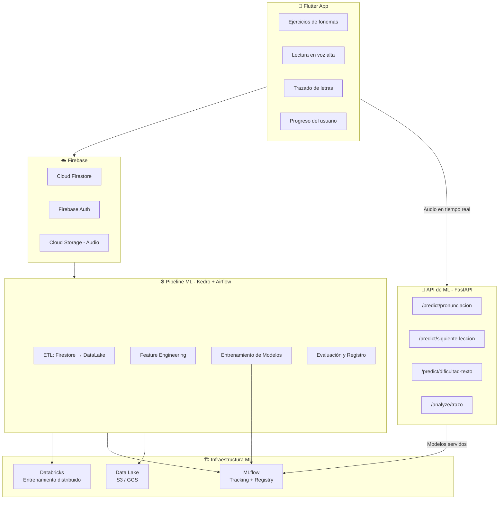

# 🧠 Pino ML — Arquitectura de Machine Learning

## Arquitectura General

## Los 4 Modelos ML de Pino

| # | Modelo | Input | Output | Uso en la app |
|---|--------|-------|--------|---------------|
| 1 | **STT Fonético** | Audio del usuario | Sílabas correctas/incorrectas + puntaje | HU-06: Lectura en voz alta con feedback |
| 2 | **Algoritmo Adaptativo** | Historial de errores | Siguiente lección óptima | HU-05: Repetición espaciada inteligente |
| 3 | **Clasificador de Dificultad** | Texto en español | Nivel de dificultad (1-5) | HU-04/17: Adaptar textos al nivel |
| 4 | **Analizador de Trazos** | Puntos del trazo | Calidad del trazo (desviación, cobertura) | HU-02/13: Feedback de grafomotricidad |

## Estado actual de cada modelo

| # | Cómo funciona hoy | Endpoint | Pendiente |
|---|-------------------|----------|-----------|
| 1 | Whisper (sin ajuste fino) + comparación de sílabas alineadas | `POST /predict/pronunciacion`, `POST /predict/fonema` (experimental) | Whisper "corrige" lo que oye hacia palabras reales y no detecta bien errores de pronunciación, sobre todo en niños. Decidir en el spike del Sprint 4–5 entre un reconocedor fonético (p. ej. wav2vec2 con CTC de fonemas), alineamiento forzado o Vosk offline. |
| 2 | SM-2 + heurística de olvido; usa un modelo GradientBoosting si existe uno entrenado | `POST /predict/siguiente-leccion` | Entrenar cuando haya datos reales (el pipeline exige mínimos). La lógica cabe en el teléfono (Dart), lo que la haría funcionar offline. |
| 3 | Reglas sobre el índice Fernández-Huerta y sílabas por palabra (spaCy) | `POST /predict/dificultad-texto` | Para un modelo ML hacen falta textos etiquetados por nivel; los datos de uso de la app no sirven para esto. |
| 4 | Distancia del trazo a la ruta ideal (por segmentos, en píxeles) + cobertura | `POST /analyze/trazo` | Solo vocales mayúsculas. No reconoce letras. HU-10 pide trazado 100 % offline: conviene portarlo a Dart. |

## Datos y entrenamiento

- **Firestore:** `usuarios/{uid}/perfiles/{syncId}/resultados/{syncId}`. `uid` es el usuario de
  Firebase Auth; `syncId` es un UUID generado en el teléfono (los IDs locales de Isar se
  repiten entre dispositivos). Reglas en `pino/firestore.rules`.
- **Pipeline Kedro (`training`):** extrae de Firestore → limpia → genera una fila por intento
  con features calculadas solo con los intentos anteriores → entrena el modelo adaptativo
  separando entrenamiento y prueba por perfil → registra métricas y modelo en MLflow.
- **Airflow:** corre el pipeline una vez por semana (en la VM o en Databricks, según
  `PINO_USAR_DATABRICKS`) y asigna el alias `produccion` solo si el modelo nuevo mejora el F1
  del actual.

