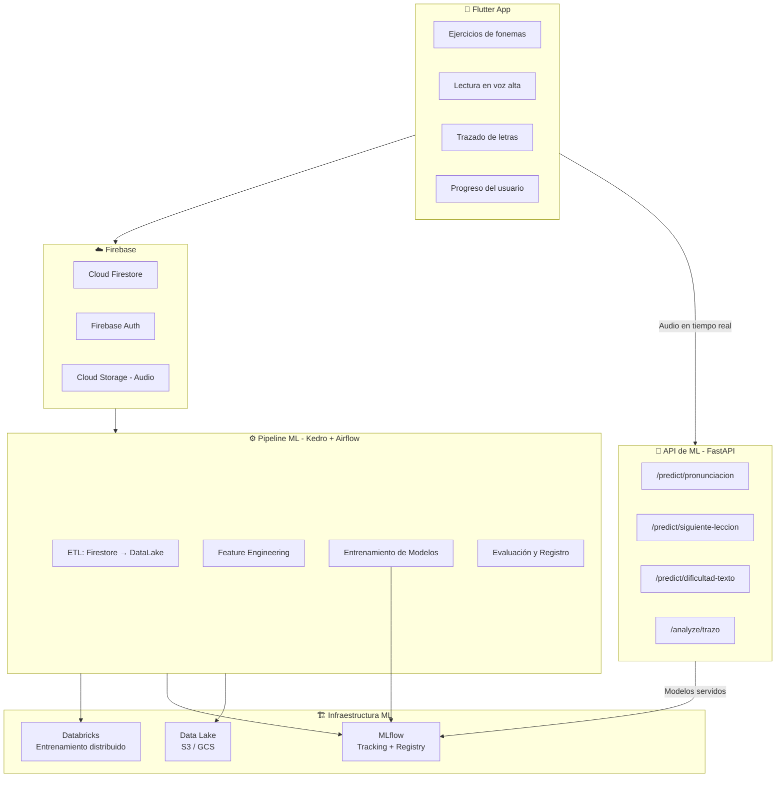

# 🧠 Pino ML — Arquitectura de Machine Learning

## Arquitectura General

## Los 4 Modelos ML de Pino

| # | Modelo | Input | Output | Uso en la app |
|---|--------|-------|--------|---------------|
| 1 | **STT Fonético** | Audio del usuario | Fonemas detectados + confianza | HU-06: Lectura en voz alta con feedback |
| 2 | **Algoritmo Adaptativo** | Historial de errores | Siguiente lección óptima | HU-05: Repetición espaciada inteligente |
| 3 | **Clasificador de Dificultad** | Texto en español | Nivel de dificultad (1-5) | HU-04/17: Adaptar textos al nivel |
| 4 | **Analizador de Trazos** | Puntos del trazo | Calidad + letra reconocida | HU-02/13: Feedback de grafomotricidad |

