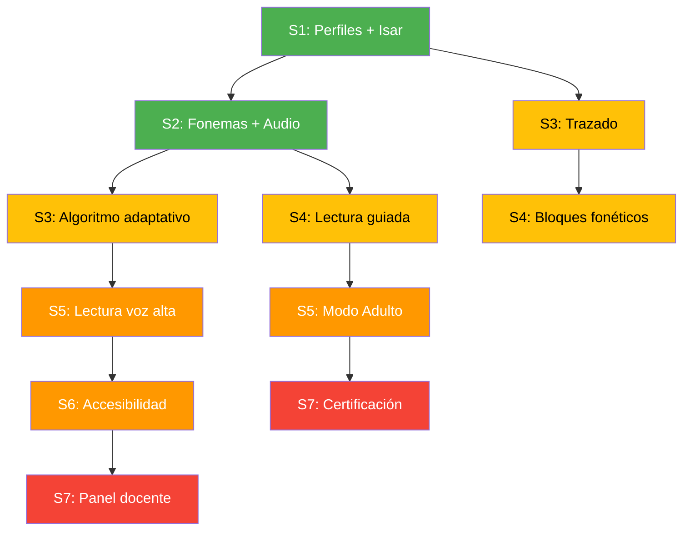

# 🗺️ Pino — Plan de Sprints (Revisado)

> **Equipo:** 4 integrantes · **Sprints:** 2 semanas c/u · **Inicio:** Semana 1  
> **Repos:** `pino/` (Flutter) + `pino-ml/` (Python ML)

---

## 👥 Roles del equipo

| Rol | Foco principal | Repos que toca |
|-----|---------------|----------------|
| **DEV-1** · Frontend UI | Pantallas, componentes, animaciones, UX | `pino/` |
| **DEV-2** · Frontend Lógica | Estado, navegación, lógica de ejercicios, integración API | `pino/` |
| **DEV-3** · Datos & Infraestructura | Isar, Firebase, sync, CI/CD, entornos | `pino/` + config |
| **DEV-4** · ML & Audio | Modelos ML, pipeline de datos, contenido pedagógico, audio | `pino-ml/` + `pino/` (audio) |

---

## 🟢 SPRINT 1 — Revisión de infraestructura + Fundamento (Semanas 1-2)

> **Meta:** Que los 4 integrantes tengan el entorno funcional, validen la arquitectura generada, y logren el flujo mínimo: abrir app → crear perfil → hacer diagnóstico.

### Semana 1: Setup + Revisión

| Tarea | Responsable | Entregable | Días |
|-------|-------------|------------|------|
| Clonar repos, instalar Flutter SDK, configurar IDE de cada dev | **Todos** | Cada dev puede compilar la app en emulador | 1 |
| Crear proyecto Firebase (consola), configurar `google-services.json` / `GoogleService-Info.plist` | **DEV-3** | Firebase conectado, Auth básico funcional | 1 |
| Revisar y validar todos los modelos Isar (`user_profile`, `exercise_result`, `phoneme`, `diagnostic_result`) — verificar que compilan con `build_runner` | **DEV-3** | Archivos `.g.dart` generados sin errores | 1 |
| Revisar arquitectura de carpetas, router, providers — identificar imports rotos o lógica faltante | **DEV-2** | Documento con lista de issues encontrados y correcciones | 2 |
| Revisar los 4 modelos ML (`stt_fonetico`, `algoritmo_adaptativo`, `clasificador_dificultad`, `analizador_trazos`) — instalar dependencias, verificar que corren | **DEV-4** | Cada modelo ejecuta sin errores con datos dummy | 2 |
| Revisar y validar `ml_api_client.dart` en Flutter — que los modelos de respuesta coincidan con la API | **DEV-2** + **DEV-4** | Contrato API-cliente verificado | 1 |
| Definir paleta de colores, tipografías y guía de estilos visual definitiva (infantil vs adulto) | **DEV-1** | Documento/Figma con guía visual aprobada por el equipo | 2 |
| Configurar Git: ramas (`main`, `develop`, `feature/*`), PR template, `.gitignore` | **DEV-3** | Flujo Git documentado y funcionando | 0.5 |

### Semana 2: Primer flujo funcional

| Tarea | Responsable | Entregable | Días |
|-------|-------------|------------|------|
| Implementar pantalla de selección de perfiles con avatares (UI real, no stub) | **DEV-1** | Pantalla funcional con grid de avatares tocables | 2 |
| Implementar pantalla de creación de perfil (nombre + avatar + modo infantil/adulto) | **DEV-1** | Flujo completo de creación con iconografía clara | 2 |
| Conectar `ProfileRepository` con Isar real — CRUD de perfiles funcionando | **DEV-3** | Crear, leer, cambiar y eliminar perfiles persiste en disco | 2 |
| Implementar lógica del diagnóstico de 3 preguntas con clasificación de nivel | **DEV-2** | Flujo: 3 preguntas → nivel detectado → guardado en perfil | 3 |
| Grabar o conseguir los primeros 10 audios de fonemas (5 vocales + m, p, s, l, n) | **DEV-4** | Archivos `.mp3` en `assets/audio/fonemas/` reproducibles | 3 |
| Conectar temas visuales: que al elegir modo infantil/adulto cambie la UI automáticamente | **DEV-2** | Tema se aplica dinámicamente según perfil activo | 1 |

### ✅ Entregable del Sprint 1
> **Demo:** Un usuario abre la app → crea perfil (nombre + avatar + modo) → hace diagnóstico de 3 preguntas → se clasifica su nivel → vuelve a home. Todo persiste en Isar. Ambos temas visuales funcionan.

### ⚠️ Riesgos a mitigar
- `build_runner` con Isar 3 funciona hoy, pero Isar 3 ya no se mantiene y fija versiones viejas de `analyzer`/`source_gen` (bloquea otros generadores). DEV-3 evalúa en día 1-2 `isar_community` (mismo API) o Drift. Hive también está abandonado: no es buena alternativa.
- Si los modelos ML no corren por dependencias de GPU, DEV-4 documenta qué necesita para Sprint 5

---

## 🟢 SPRINT 2 — Fonemas + Audio Core (Semanas 3-4)

> **Meta:** El usuario puede explorar fonemas, escuchar sonidos, y hacer ejercicios de emparejamiento. Sistema de audio completo.

### DEV-1 (Frontend UI)
- Implementar pantalla **Explorador de Fonemas**: grilla de letras/sílabas con botón de audio
- Implementar pantalla **Emparejamiento**: escuchar sonido → elegir entre 2-3 opciones
- Diseñar animaciones de feedback (correcto: confeti/check, incorrecto: shake suave)
- Implementar componente `TappableText` — tocar cualquier palabra para escucharla

### DEV-2 (Frontend Lógica)
- Implementar lógica del ejercicio de emparejamiento (generar opciones, verificar respuesta)
- Conectar `PhonemeProvider` con repositorio Isar — guardar resultados de cada ejercicio
- Implementar lógica de desbloqueo: 3 aciertos seguidos → abrir siguiente grupo de fonemas
- Implementar navegación completa Home → Fonemas → Ejercicio → Resultado → Home

### DEV-3 (Datos & Infra)
- Implementar precarga del catálogo de 31 fonemas en Isar al primer uso
- Implementar `ExerciseResult` — guardar cada intento con su detalle
- Comenzar implementación del `SyncService` — sincronizar perfil con Firestore cuando hay red
- Configurar reglas de seguridad de Firestore (cada usuario solo ve sus datos)

### DEV-4 (ML & Audio)
- Completar banco de audio: 31 fonemas puros (a-z, ch, ll, rr, gu, qu, ñ) en español neutro
- Implementar `AudioService` — reproducción con baja latencia y precarga
- Implementar `TtsService` — integrar `flutter_tts` para leer palabras al tocarlas
- Levantar la API de ML localmente (`uvicorn`) y verificar endpoint `/predict/fonema`

### ✅ Entregable del Sprint 2
> **Demo:** Usuario explora grilla de fonemas → toca letra → escucha sonido puro → entra a ejercicio de emparejamiento → escucha fonema → elige opción → feedback visual/sonoro → resultado se guarda. Cualquier palabra tocable reproduce su pronunciación.

---

## 🟡 SPRINT 3 — Trazado + Racha + Repetición (Semanas 5-6)

> **Meta:** Grafomotricidad funcional, sistema de racha diaria, y primer ciclo del algoritmo adaptativo.

### DEV-1
- Implementar **Canvas de trazado**: trazo punteado con flechas de dirección
- Implementar feedback visual al completar trazo (animación de éxito + fonema suena)
- Implementar pantalla de **Racha diaria**: contador, calendario visual, recompensas
- Diseñar recompensas diferenciadas: personajes (infantil) vs medallas (adulto)

### DEV-2
- Implementar detección de desviación del trazo vs ruta ideal (algoritmo local)
- Implementar ajuste de tolerancia de trazo: Baja/Media/Alta (HU-13) — configurable y auto-calibrable
- Implementar **registro de errores por tipo** (confusión de letras, longitud, etc.)
- Implementar lógica de **repaso espaciado v1**: priorizar fonemas con menor tasa de acierto

### DEV-3
- Implementar lógica de racha: marcar día completado, calcular consecutivos, mejor racha
- Implementar detección de sesión mínima de 5 minutos para validar día
- Refinar sync: enviar resultados de ejercicios a Firestore en batch cuando hay conexión
- Verificar que todo funciona 100% offline (modo avión)

### DEV-4
- Crear datos vectoriales de trazos ideales para vocales (A, E, I, O, U) y consonantes iniciales (M, P, S)
- Verificar que el endpoint `/analyze/trazo` de la API ML funciona con datos reales del canvas
- Grabar audios de feedback: sonido de éxito, sonido de reintento, sonido de racha
- Comenzar a documentar el contenido pedagógico necesario para Sprint 4

### ✅ Entregable del Sprint 3
> **Demo:** Usuario traza letras siguiendo guía → feedback por desviación → fonema suena al completar. Contador de racha funciona. El sistema prioriza fonemas débiles en el próximo ejercicio.

---

## 🟡 SPRINT 4 — Lectura guiada + Bloques fonéticos (Semanas 7-8)

> **Meta:** Ejercicios de comprensión lectora y construcción de oraciones con sílabas.

### DEV-1
- Implementar pantalla de **Lectura guiada**: texto con opción de lectura frase a frase (TTS)
- Implementar **palabras clickeables** dentro del texto con definición contextual (audio + texto)
- Implementar pantalla de **Bloques fonéticos** (HU-18): drag & drop de sílabas para armar oraciones
- Diseñar ilustraciones guía para los ejercicios de bloques (o integrar placeholders)

### DEV-2
- Implementar preguntas post-lectura: causa-efecto, idea principal (no solo memoria)
- Implementar lógica de bloques fonéticos: validar orden, feedback al soltar bloque incorrecto
- Implementar reproducción de frase concatenada al armar oración correcta
- Conectar clasificador de dificultad: consultar API para adaptar textos al nivel del usuario

### DEV-3
- Implementar sección protegida por PIN para tutores (HU-09)
- Implementar panel de reporte básico: tiempo de uso, palabras dominadas, fonemas débiles
- Implementar gráfica simple de fonemas con mayor tasa de error
- Implementar temporizador de sesión para perfil infantil (HU-16): 15/30/45 min configurables

### DEV-4
- Crear contenido: 10 textos de lectura guiada graduados por nivel (1-5)
- Crear preguntas de comprensión para cada texto (2-3 por texto)
- Crear banco de oraciones para bloques fonéticos con sus sílabas e ilustraciones
- Validar endpoint `/predict/dificultad-texto` con los textos creados

### ✅ Entregable del Sprint 4
> **Demo:** Usuario lee texto adaptado → escucha frase a frase → toca palabras difíciles → responde preguntas de comprensión. En otro módulo, arma oraciones arrastrando sílabas. Tutor puede ver reportes con PIN.

---

## 🟠 SPRINT 5 — Modo Adulto + Voz (Semanas 9-10)

> **Meta:** Contenido funcional para adultos y primera versión de lectura en voz alta.

### DEV-1
- Implementar pantalla de **Documentos interactivos** (HU-11): boleta de luz/agua simplificada
- Implementar pantalla de **Letreros y transporte** (HU-12): ejercicios visuales con carteles
- Implementar pantalla de **Lectura en voz alta** (HU-06): botón grabar + visualización de resultado
- Diseñar UI de feedback de pronunciación: sílabas verdes (correctas) y rojas (incorrectas)

### DEV-2
- Implementar lógica de documentos: resaltar zonas críticas, preguntas de validación
- Implementar ejercicios de discriminación visual rápida (3 letreros, elegir el correcto)
- Implementar flujo de grabación: permisos de micrófono → grabar → enviar a API → mostrar resultado
- Implementar micro-historias con razonamiento inferencial (HU-17): resaltar pistas al fallar

### DEV-3
- Implementar multiperfil robusto: verificar aislamiento completo de datos entre perfiles
- Optimizar rendimiento de Isar con volumen real de datos (100+ ejercicios por perfil)
- Implementar sugerencias de actividades offline para el panel de tutores (HU-09)
- Comenzar preparación para exportación de reportes (CSV básico)

### DEV-4
- **Spike técnico**: evaluar Whisper vs Vosk para STT offline en español
- Afinar modelo `stt_fonetico.py` — probar con grabaciones reales de usuarios
- Crear contenido: 5 documentos interactivos (boleta luz, agua, medicamento, contrato simple, recibo)
- Crear contenido: 8 letreros de transporte/señalética para ejercicios visuales

### ✅ Entregable del Sprint 5
> **Demo:** Adulto practica con boleta de luz → toca monto → escucha explicación → responde pregunta. Lee palabra frente al micrófono → ve qué sílabas pronunció bien/mal. Identifica destinos en letreros de buses.

---

## 🟠 SPRINT 6 — Accesibilidad + Localización (Semanas 11-12)

> **Meta:** Modo analfabeto navegable por voz, primera variante dialectal, y pulido general.

### DEV-1
- Implementar **Modo Analfabeto** (HU-07): todos los botones leen su función al tocarlos
- Implementar íconos representativos en todas las pantallas (sin depender de texto)
- Implementar botón flotante "¿Dónde estoy?" omnipresente
- Implementar pantalla de **Lectura cooperativa** (HU-19) v1: turnos visuales claros

### DEV-2
- Implementar lógica de "toque simple = audio, doble toque = acción" para modo analfabeto
- Implementar selector de variante dialectal en configuración (HU-22)
- Implementar carga dinámica de vocabulario regional según dialecto seleccionado
- Implementar sesión cooperativa: turno de guía / turno de aprendiz, micrófono alterno

### DEV-3
- Implementar exportación de reportes en PDF y CSV (HU-09, HU-20)
- Implementar sincronización completa bidireccional Isar ↔ Firestore
- Testing de rendimiento offline con datos acumulados de 5 sprints
- Preparar estructura para panel web docente (HU-20) — definir API necesaria

### DEV-4
- Implementar primera variante dialectal: **México** (vocabulario + ejemplos adaptados)
- Ajustar motor TTS para prosodia regional (si el motor del OS lo permite)
- Grabar/adaptar audios para variante dialectal mexicana
- Documentar proceso para agregar variantes futuras (Chile, Argentina, Colombia)

### ✅ Entregable del Sprint 6
> **Demo:** Usuario analfabeto navega toda la app solo con toques y audio. Botón "¿Dónde estoy?" funciona. Un usuario mexicano ve "fresa" y un chileno ve "frutilla". Lectura cooperativa básica con turnos.

---

## 🔴 SPRINT 7+ — Certificación, Panel Docente y Escala (Semana 13+)

> **Meta:** Features de plataforma institucional y certificación.

### Tareas principales (asignación según capacidad)
- [ ] **HU-20**: Panel web docente con mapa de calor fonético — requiere proyecto web separado (React/Next.js)
- [ ] **HU-21**: Examen final + certificado PDF con QR verificable — requiere servicio de generación de PDF y validación
- [ ] **HU-22**: Variantes dialectales adicionales (Chile, Argentina, Colombia)
- [ ] **HU-19**: Lectura cooperativa v2 con evaluación diferenciada por participante
- [ ] Testing con usuarios reales (niños + adultos)
- [ ] Preparación para publicación en Play Store / App Store
- [ ] Documentación técnica y pedagógica completa

---

## 📅 Vista de calendario

```mermaid
flowchart LR
    subgraph S1["🟢 Sprint 1 · Sem 1-2"]
        A1["Setup + Revisión\ninfra generada"]
        A2["Perfil + Diagnóstico\nfuncionando"]
    end
    subgraph S2["🟢 Sprint 2 · Sem 3-4"]
        B1["Fonemas + Audio"]
        B2["Emparejamiento"]
    end
    subgraph S3["🟡 Sprint 3 · Sem 5-6"]
        C1["Trazado de letras"]
        C2["Racha + Algoritmo v1"]
    end
    subgraph S4["🟡 Sprint 4 · Sem 7-8"]
        D1["Lectura guiada"]
        D2["Bloques fonéticos"]
    end
    subgraph S5["🟠 Sprint 5 · Sem 9-10"]
        E1["Modo Adulto"]
        E2["Lectura voz alta"]
    end
    subgraph S6["🟠 Sprint 6 · Sem 11-12"]
        F1["Accesibilidad"]
        F2["Localización"]
    end
    subgraph S7["🔴 Sprint 7+ · Sem 13+"]
        G1["Panel docente"]
        G2["Certificación"]
    end
    S1 --> S2 --> S3 --> S4 --> S5 --> S6 --> S7
```

---

## 📋 HU cubiertas por sprint

| Sprint | HUs | Cobertura |
|--------|-----|-----------|
| **S1** | HU-01, HU-15 (parcial) | Perfil, diagnóstico, multiperfil básico |
| **S2** | HU-03, HU-14, HU-10 (parcial) | Fonemas, tap-to-speech, offline básico |
| **S3** | HU-02, HU-05 (parcial), HU-08, HU-13 | Trazado, racha, tolerancia, repaso espaciado |
| **S4** | HU-04, HU-09, HU-16, HU-17, HU-18 | Lectura, bloques, tutor, temporizador |
| **S5** | HU-06, HU-11, HU-12, HU-15 (completo) | Voz, documentos, letreros, multiperfil robusto |
| **S6** | HU-07, HU-19, HU-22 (parcial) | Modo analfabeto, cooperativa, dialectos |
| **S7+** | HU-20, HU-21, HU-22 (completo) | Panel docente, certificación, más dialectos |

---

## 🔑 Dependencias críticas entre sprints

---

## 🎯 Definition of Done por sprint

Cada sprint se considera terminado cuando:

- [ ] Todas las tareas asignadas tienen PR mergeado a `develop`
- [ ] La demo del entregable funciona en emulador Android sin crashes
- [ ] Funciona en modo offline (si aplica al sprint)
- [ ] Funciona con ambos perfiles (infantil y adulto)
- [ ] Audios se reproducen correctamente (si aplica)
- [ ] Cada PR fue revisado por al menos 1 compañero
- [ ] Se documentaron los issues encontrados para el siguiente sprint

---

## ⚡ Decisiones pendientes para Sprint 1

| Decisión | Quién decide | Cuándo |
|----------|-------------|--------|
| ¿Seguir con Isar 3, migrar a `isar_community` o a Drift? | DEV-3 | Día 2 |
| ¿Audios grabados por el equipo o generados con TTS profesional? | DEV-4 + equipo | Día 3 |
| ¿Diseño en Figma previo o directo en código? | DEV-1 + equipo | Día 1 |
| ¿Usar emulador de Firebase local para desarrollo? | DEV-3 | Día 2 |
| ¿Whisper (requiere GPU) o Vosk (offline, CPU)? — Spike para Sprint 5 | DEV-4 | Sprint 4 |
